<div align="center">

# Crash Twinsanity for Windows

**Crash Twinsanity (PlayStation 2) running natively on your PC, on Windows and Linux.
No emulator.**

[](https://github.com/GioPixelGH/Crash-Twinsanity-Windows/releases/latest)
[](https://github.com/GioPixelGH/Crash-Twinsanity-Windows/releases)
[](https://github.com/GioPixelGH/Crash-Twinsanity-Windows/discussions)
[](#licence)


[Play it](#play-it) · [Is it safe?](#is-it-safe) · [Questions](#questions-people-ask-first) · [Features](#features) ·
[Status](#status) · [Known issues](#known-issues) · [If something goes wrong](#if-something-goes-wrong) ·
[Roadmap](#roadmap) · [Building](#building-on-windows) · [Credits](#credits)

</div>

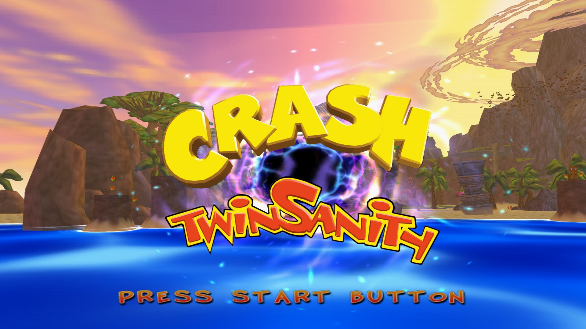

> [!IMPORTANT]
> **Bring your own copy.**
> No game files are included.
> You need a disc image of your own PAL copy of the game (Europe/Australia, SLES-52568).
> A translated or modded copy of the PAL disc works too.
> Since 1.4.0, so does the North American disc, version 2.00 (SLUS-20909).
>
> Crash Twinsanity and Crash Bandicoot are trademarks of Activision.
> PlayStation is a trademark of Sony Interactive Entertainment.
> This is a fan project, not affiliated with or endorsed by either.
> Please don't ask for the game's files or disc images in the issues: such requests are closed.

This port is built on two projects.
[Smartkin's decompilation](https://github.com/Smartkin/twinsanity-reversed) rewrote the whole game in C++.
[HAB3X's port for Mac](https://github.com/HAB3X/Crash-Twinsanity-Mac) made it run natively.
This repository brings it to Windows and Linux, keeps it at a steady 60 fps, and fixes what playing it turned up.

## Play it

### What you need

- 64-bit Windows 10 or 11, or 64-bit Linux.
- A graphics card with OpenGL 3.3 or Vulkan.
  Any card from the last ten years has them.
- A disc image of **your own** PAL copy of the game, as an `.iso`, `.bin` or `.img`.
  The North American disc, version 2.00, works too.
- A keyboard and mouse, or a controller.
  Xbox, PlayStation, Switch and most other controllers work out of the box.

### On Windows

1. Download `Crash-Twinsanity-Windows.zip` from the [latest release](https://github.com/GioPixelGH/Crash-Twinsanity-Windows/releases/latest).
2. Unzip it anywhere you like.
3. Open the `Crash Twinsanity` folder and run `CrashTwinsanity.exe`.
4. If Windows says "Windows protected your PC", choose **More info**, then **Run anyway**.
   The program isn't code-signed.
5. Pick your disc image.
   The game remembers it.

That's all.
The [players' guide](native/PLAYING_WINDOWS.md) explains the options, the controls, the saves and the mods.

### On Linux and the Steam Deck

1. Download `Crash-Twinsanity-Linux-x86_64.AppImage` from the [latest release](https://github.com/GioPixelGH/Crash-Twinsanity-Windows/releases/latest).
2. Make it executable: `chmod +x Crash-Twinsanity-Linux-x86_64.AppImage`.
3. Run it, and pick your disc image.

It needs glibc 2.38 or later: Ubuntu 24.04, Linux Mint 22, Debian 13, Fedora 39, Arch, or newer.
On older systems, such as Ubuntu 22.04, Debian 12 or Linux Mint 21, you can build it yourself with [native/LINUX.md](native/LINUX.md).

On a Steam Deck it starts fullscreen on the Deck's screen.
[native/LINUX.md](native/LINUX.md) shows how to add it as a non-Steam game.
Nobody has tried it on a Deck yet, so **testers are wanted** ([#34]).

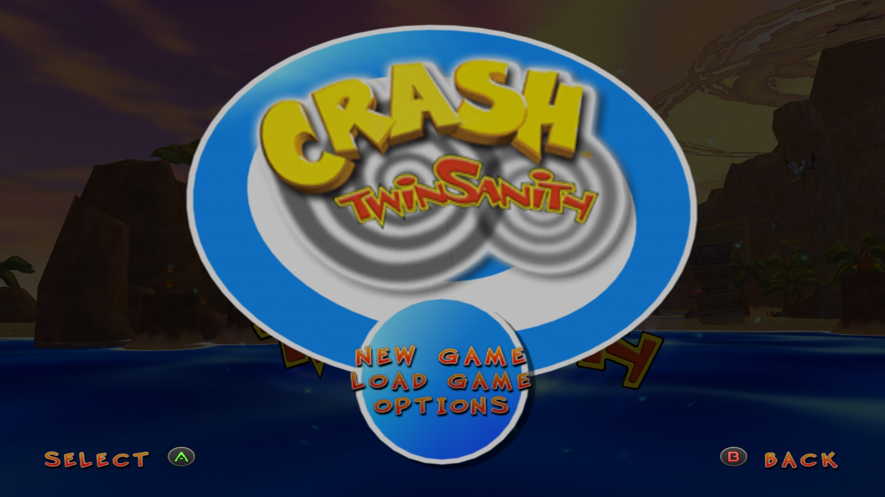

## Is it safe?

- The download holds only the program, its two libraries (SDL 3 and FFmpeg), its fonts and the licences.
  There's no installer.
- The program goes online only if you turn on **Check for updates** (Options > Game, off by default).
  Then, at each start, it asks GitHub which version is the latest.
  It sends no personal data, and it never downloads or installs anything.
  The Linux version has no update check at all.
- Each download has a `.sha256` file beside it on the release page, with the download's SHA-256.
  On Windows, `Get-FileHash` prints your download's, to compare.
  On Linux, `sha256sum -c` checks it for you.
  Here is [VirusTotal's report on 1.0.12's download](https://www.virustotal.com/gui/url/6ed9050e25993157d30ef77a69c4b7e7aba61368c9669caca1caf95553cd1e90/detection).
- Since 1.4.0, each download is scanned with Microsoft Defender before it's published.
  The release notes give the result.
- You can also build it yourself from this code ([below](#building-on-windows)).

[SECURITY.md](.github/SECURITY.md) has the details, and how to report a security problem privately.

## Questions people ask first

**Do I need an emulator or a PS2 BIOS?**
No.
It's a Windows or Linux program of its own.
It only reads the game's data from your disc image.

**Where do I get the game?**
From your own disc.
Copy it into an `.iso` with a PC's DVD drive and a disc-copying program, such as ImgBurn on Windows.
Nobody here can share the game's files.

**Does the North American disc work?**
Yes, since 1.4.0, if it's version 2.00 (SLUS-20909) ([#14]).
It plays in English, the only language on that disc, and keeps its saves on a memory card of its own.
Mods are made for the PAL disc, so they aren't used with it.
Version 1.00 and the Japanese disc don't work, and the game says so.
Translated or modded copies of the PAL disc work too.

**Is the game changed?**
No.
By default it plays as the PS2 original, bugs included.
Everything that changes the game, such as the bug fixes, the cutscene skip or infinite lives, is an option.
It stays off until you turn it on.

**Why is it slow on my older PC?**
The port draws the PS2's graphics the way the PS2's graphics chip does, on your processor.
That's hard work for older processors.
Since 1.4.0 there's a fast renderer, still experimental, in **Options > Display > Renderer > Renderer**.
It draws the scenery more directly, and it should look the same.
Try it, and the settings in [If something goes wrong](#if-something-goes-wrong).

**Does it play at more than 60 fps?**
Yes: 120, 144 or unlimited, in Options > Display.
The game keeps the same speed.
Two chases play at 60 fps whatever you choose, Bandicoot Pursuit ([#44]) and the walrus chase in High Seas Hi-Jinks ([#17]), because above 60 they went wrong.
The rate you chose comes back as soon as you leave them.
60 is still the safest choice.

**Do texture packs and mods work?**
Yes.
PCSX2's texture packs for this game work as they are ([how](#texture-packs)).
Mods that change the game's files work too: levels, texts, pictures, sounds and movies.
Changes to the game's program don't apply ([why](native/MODDING.md#limits)).
The [modding guide](native/MODDING.md) shows how to add mods.

**Is there a version for Mac, Android or 32-bit Windows?**
Not from here.
It needs 64-bit Windows 10 or 11, or 64-bit Linux.
For a Mac, look at [HAB3X's port for Mac](https://github.com/HAB3X/Crash-Twinsanity-Mac), which this one is built on.

**Where are my saves?**
On Windows in `%APPDATA%\Crash Twinsanity\`, on Linux in `~/.config/crash-twinsanity`.
Your settings are there too ([more](#if-something-goes-wrong)).

**Where can I ask for help?**
In the [Discussions](https://github.com/GioPixelGH/Crash-Twinsanity-Windows/discussions).
Bugs go in the [issues](https://github.com/GioPixelGH/Crash-Twinsanity-Windows/issues): [what to include](#if-something-goes-wrong).

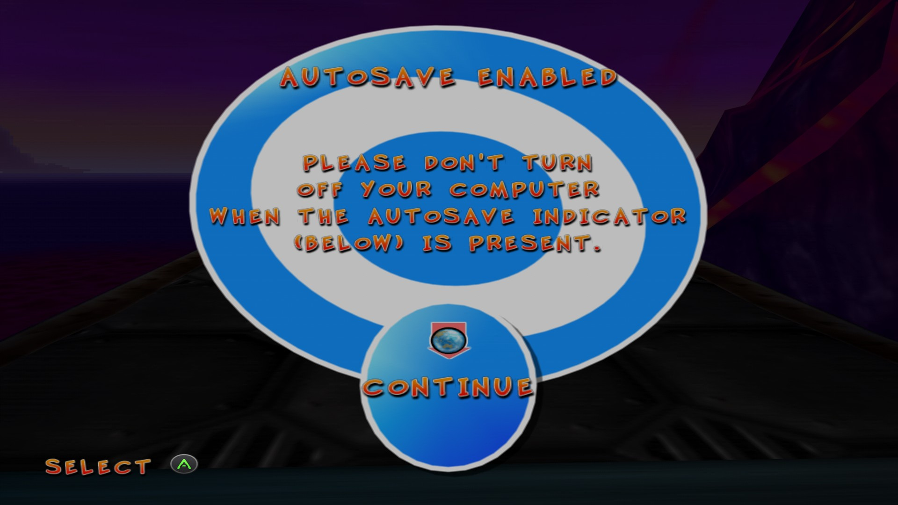

## Features

**Looks**

- Up to 8 times the PS2's resolution, with the characters drawn as they look on the PS2.
- Widescreen in 16:10, 16:9, 21:9 and 32:9, besides the original 4:3.
  16:10 fits the Steam Deck's screen.
  At 32:9 the menus and the HUD stay in the middle.
- Smooth edges with FXAA, SMAA, or supersampling at 2x or 4x.
- Anisotropic filtering up to 16x, for sharp textures seen at an angle.
- The PS2's dithering, or off for full colour.
- A longer draw distance, if you'd like grass and small things to appear sooner.
  It also keeps the particles near Crash when the camera is far away ([#60]).
- HD texture packs made for PCSX2 work as they are ([how](#texture-packs)).
  Packs in BC7 and the other compressed DDS kinds stay compressed on the graphics card, so they need much less memory ([#55]).

**Smoothness**

- A steady 60 fps, or 50, 120, 144 or unlimited, always at the same game speed.
  Above 60, two chases play at 60 ([#17], [#44]).
- No pauses to prepare graphics when you reach a new area.
- OpenGL or Vulkan, your choice ([#37]).
  OpenGL is the default.
  Vulkan came in 1.3.0, and testers are wanted.
- If a start fails with one of them, the game uses the other.
- A fast renderer for older processors, new in 1.4.0 and still experimental.

**Playing**

- Keyboard and mouse, or any controller, with every key and button remappable.
- The menus show the buttons of the controller you're using.
- The settings open while you play, with F1 or with Select+Start on a controller.
- On the Display and Accessibility tabs, the game shows behind the settings, so you see each change at once.
- A master volume, and a choice of the monitor the game opens on.
- The disc you're playing shown in the options, where you can pick another disc image.
- The text language and the voice language chosen separately: English text with French voices, for example.
- Saves that work like a PC game's, with no memory card screens.
- Portable mode: everything kept in the game's folder, to carry it on a USB stick.

**Game options** (all off by default, so the game stays the original)

- Skip cutscenes, now including 42 of the game's 51 scripted ones ([#28]).
- Infinite lives.
- A stronger Aku Aku: one or two masks protect you from TNT and Nitro ([#30]).
- With three masks on, a touch breaks crates and beats enemies within a spin's reach, as in the earlier Crash games ([#18], [#56]).
- Three masks' invincibility for 20 seconds, as in the earlier games, instead of 8 ([#56]).
- An automatic camera that swings behind you by itself ([#42]).
  Or an assisted one, which you still turn, and which swings behind you once you let go.
- The slide's long jump at any moment, or an easier one ([#11], [#35]).
- A double jump later in a fall, at any moment of it, or after a slide jump ([#47]).
- Improved menus ([#48]).
  The main menu gets Continue, which loads your newest save, and Quit to desktop ([#33]).
  The pause menu starts at the top and has the gems and the extras as rows.
- Restart Checkpoint in the pause menu, which the PS2's pause menu doesn't have.
- Level select, from the gems' pages in the main menu or the pause menu ([#48]).
  Its saves are kept apart from yours.
- A speedrun timer.
- A shadow under you in the air, with a yellow ring if you like, so it shows on dark ground too ([#11]).
  The ring grows as you jump and shrinks as you land.
- Aku Aku's shadow ([#51]), and your shadow on crates.
- Bug fixes for eight bugs of the original game: the masks' particles and stars, and Aku Aku lost after the fight ball's ride into Dingodile's hut ([#18]), Rockslide Rumble's smoke ([#41]), outline crates broken before their "!" crate ([#58]), and Evil Crash in Bandicoot Pursuit.

**Mods**

- Mods as the community shares them, Crate Mod Loader's Mod Crates and new levels included ([#36]).
- A mod's zip or a modded disc image imported from Options > Mods.
- Each mod turned on or off, in the order you choose.
- Saves made with mods kept on a memory card of their own.
- A [modding guide](native/MODDING.md) to make your own.

<details>
<summary><b>What changed under the hood</b> (for the curious)</summary>

On top of HAB3X's port (its GPU renderer, widescreen and 21:9, HD texture packs, remappable keyboard, mouse and controller, saves, cutscene skipping and community fixes), this port adds:

- **Windows support:** Windows' calling convention, which passes float arguments differently from the PS2's; the retail code's reads of address 0, emulated on Windows; frame pacing and file access; a crash report with a backtrace and the area the player was in.
- **Speed:** the game, the PS2's vector unit (VU1) and the graphics run on three threads, and the renderer's hot paths are faster.
  The graphics' shader programs are made when the game starts.
  Since 1.3.0 the renderer makes about a sixth of the OpenGL calls it made, and decodes a quarter of the texels it did for the shadows and the colour filter.
- **The fast renderer** (experimental, since 1.4.0) runs the scenery's VU1 program as native code, with the same results bit for bit, and draws each strip of triangles at once instead of a shape at a time.
  Its results were compared with the accurate renderer's in every area the level sweep plays, and none differed.
- **OpenGL and Vulkan:** since 1.3.0 the renderer records each frame as a list of commands, and OpenGL or Vulkan draws it.
  Vulkan goes through SDL's GPU API, its shaders made from the OpenGL ones by glslang.
  The design follows [Tenkaichi3Decomp's](https://github.com/z3xox/Tenkaichi3Decomp) renderer.
  A start that never shows its pictures leaves a note, so the next start takes the other API.
- **Screens and graphics cards:** the window opens on the monitor you pick, remembered by its name.
  On a laptop with two graphics cards, the game asks the graphics driver for the faster one.
- **Resolution:** 6x and 8x added.
  A buffer the graphics card can't hold at the chosen scale is drawn by the software renderer instead of failing.
- **Anti-aliasing:** SMAA is [iryoku's](https://github.com/iryoku/smaa).
  Supersampling draws the picture 2 or 4 times larger, up to 8x the PS2's, and shrinks it to the window.
- **Draw distance** comes from HAB3X's Mac port: short, original (the default), medium, long or unlimited.
- **Languages:** a translated disc's texts are recognised by their language ([#25]).
- **Cutscene skip:** besides the developers' own skips, the others end the scene's waits in order (TwinsanityEvolved's skip, with its author's permission).
  Each one was checked to end as when watched.
- **Frame rates above 60:** Crash's own movement and the rigid bodies, such as Evil Crash's jumps, keep their 60 Hz timing.
  The two chases that still went wrong play at 60 Hz until the game's steps are kept at 60 for every rate.
- **Texture packs:** a pack's BC1, BC2, BC3 and BC7 DDS files go to the graphics card compressed, with their own mipmaps, and leave RAM once there.
- **Level select** comes from HAB3X's Mac port, on a memory card of its own.
- **Quit to desktop, a Credits page, and the update check** (Windows only) are in Options > Game.
- **Mods:** each mod is a folder in `%APPDATA%\Crash Twinsanity\mods`, a Mod Crate as it comes or files laid out as the disc's.
  Files put straight in the mods folder replace the disc's, as before.
- **Fixes:**
  - The crash entering the first boss's area (a level title picture read wrongly).
  - The crash during the Mecha-Bandicoot fight (a float argument on Windows).
  - Crashes in the caverns (a reference to an object already freed, an animation of zero length).
  - VU1 programs that ran away (two copies of the same data declared with different sizes).
  - The characters at high resolutions: the game's distance haze and the first boss's sky at the chosen resolution (no more stepped outlines), the colours VU1 writes after sending its vertices (no more patches on the bodies), triangles thinner than a PS2 pixel (no more thin black lines), and textures' detail for the chosen resolution.
  - Ant Agony's metal doors, walls and floors, which were read from an old buffer of the first boss's area ([#32]).
  - The story movies' rare crash ([#49]), from the movie decoder reading a little past each piece of the movie.
  - Vulkan's stops of 4 to 6 seconds ([#55]), when the renderer let go of thousands of textures at once.
  - The level select's memory card, which took your own saves' list on its first autosave ([#38]).
    Your own card was never written.
  - Under the Bug fixes option: the masks' invincibility particles lost in the next area, two masks' stars lost after a cutscene, three masks' particles stuck after a hurt, two masks' particles left in the final boss's arena, Aku Aku released by the hut's scene after the fight ball's ride ([#18]), Rockslide Rumble's endless explosions where its purple smoke belongs ([#41]), outline crates set off by an explosion before their "!" crate ([#58]), and Bandicoot Pursuit's Evil Crash standing still.
- **Controllers:** a modern controller's round stick is mapped to the PS2 stick's square, so Crash runs on diagonals too.
- **The game's data from your disc:** the program carries none of it.
  It reads the data from your disc image's executable when it starts, checks which release it is, and says so clearly when the disc image is wrong.
  The log says what the image is (the retail disc, a modified copy or an unknown image), by redump.org's dumps.
- **The North American disc:** its program is the PAL one built again, with the same code at other addresses.
  The port runs the PAL program on that disc's data, through a map of where each piece of data is in its executable.
  TwinsanityEvolved's region map tool makes the map, and each difference between the two discs was decided one by one.

[native/WINDOWS.md](native/WINDOWS.md) explains each change, why it was needed and how it was tested.

</details>

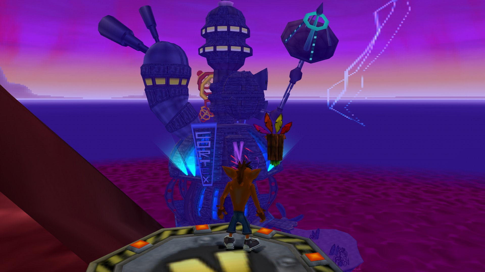

## Status

- **Tested on Windows 11** with an NVIDIA GeForce RTX 4070 SUPER, keyboard and mouse, and an Xbox One controller.
- **Played by hand from the start to the credits**, in Italian with an Xbox One controller, on the releases up to 1.0.7.
  Every crash found on the way is fixed.
- **All 131 of the game's areas were tried** with scripted input, 30 seconds each, with no unexpected crash ([results](native/sweep/results_windows.md)).
  108 played.
  The other 23 can only be entered from a neighbouring area.
- **The North American disc**, new in 1.4.0, has checks of its own, and all its areas were tried as the PAL disc's were.
- **Vulkan**, new in 1.3.0, is tested on the same PC.
  There the checks' pictures come out the same as OpenGL's.
  Each release also starts it on Linux with Mesa's Vulkan on the processor.
  Players have played with it on an NVIDIA GeForce GTX 1650 ([#55]) and on a ROG Ally ([#65]).
- **Linux:** built and checked with each release since 1.2.0.
  It plays on x86-64 (tried on Debian 13).
- **macOS:** HAB3X's code for it is still here, but this fork isn't built or tested on macOS.

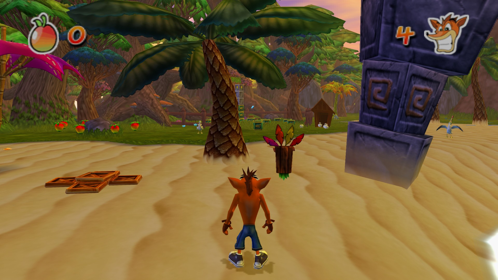

## Known issues

- **Older PCs can run well below 60 fps** ([#23], [#39]).
  The PS2's graphics are emulated on the processor, which is hard work for older ones: a two-core laptop processor from 2011 ran it at 18 fps.
  The fast renderer of 1.4.0 helps, and more of it is on the roadmap.
- **The fast renderer is experimental.**
  It should look the same as the accurate one, which stays the default.
  If something looks different with it, please tell us.
- **A black screen at start on a few AMD PCs** ([#12], [#16]).
  It doesn't happen on the PC the port is tested on.
  Since 1.3.0, a start that hangs before its first pictures makes the next one use the other graphics API.
  A log from an affected PC still helps.
- **The camera can stop following Crash after a high path scene** ([#23], [#52]).
  It wasn't reproduced here yet.
  The detailed log now says what the camera was doing when it happens.
- **Vulkan has been tried on few PCs** ([#37]), so OpenGL stays the default.
  Testers with other graphics cards are wanted.
- **The Steam Deck hasn't been tried** ([#34]).
  Testers wanted.

## If something goes wrong

| Problem | What to do |
| --- | --- |
| Windows says "Windows protected your PC" | Choose **More info**, then **Run anyway**. The program isn't code-signed. |
| The game asks for the disc image again | You moved or renamed it. Pick it again. To use a different one, select **Options > Game > Disc** and pick it. |
| The game refuses the disc image | It takes the PAL disc (SLES-52568), a translated or modded copy of it, or the North American disc, version 2.00 (SLUS-20909). The North American version 1.00 and the Japanese disc don't work. |
| A black screen at start | If the game doesn't respond, end it in the Task Manager and start it again. The next start uses the other graphics API. Update your graphics card's driver too. If it stays black, attach `log.txt` on [#16]. |
| Below 60 fps | In Options > Display, set Resolution to 1x, Draw distance to short, and Anti-aliasing off. You can also try Vulkan, under Graphics API, and the fast renderer, under Renderer. Then attach `log.txt` on [#23]: it says where each frame's time goes. |
| A laptop's `log.txt` names its built-in graphics card | In Windows' **Settings > System > Display > Graphics**, choose **High performance** for `CrashTwinsanity.exe`. |
| A pause when a new area appears | The first start after a graphics driver update takes a little longer. If the game still pauses while you play, attach `log.txt`: its `slow frame` lines say why. |
| Sounds or a level wrong with mods on | Turn the mods off in Options > Mods, then restart. Saves made with mods are on their own memory card, so yours come back as soon as all mods are off. |

**Before you report a bug**

1. Make sure you have the [latest release](https://github.com/GioPixelGH/Crash-Twinsanity-Windows/releases/latest).
2. Search the [issues](https://github.com/GioPixelGH/Crash-Twinsanity-Windows/issues?q=is%3Aissue) to see if it's known.
3. Attach `log.txt`.
   After a crash or a freeze, start the game again and attach `log.previous.txt` too: that's the run that went wrong.
4. Say where in the game it happened, and add a screenshot or a video if you can.

For a bug you can repeat, turn on **Options > Game > Detailed log** first.
Never attach your disc image or the game's files.
Questions and help are welcome in the [Discussions](https://github.com/GioPixelGH/Crash-Twinsanity-Windows/discussions).

**Where your saves and settings are**

Saves, options, controls, mods, texture packs and `log.txt` are all in one folder:

- on Windows, `%APPDATA%\Crash Twinsanity\` (paste that in the Explorer's address bar);
- on Linux, `~/.config/crash-twinsanity`;
- with **Options > Game > Portable mode** on, the `User` folder beside the program.

To uninstall, delete the game's folder and that one.
The [players' guide](native/PLAYING_WINDOWS.md#where-things-are) lists every file.

## Roadmap

Plans, not promises, roughly from the quickest to the longest.
New game options will be off by default, so the game stays the original.

- [ ] The rest of the port's own texts in Brazilian Portuguese ([#25]).
  1.4.0 has NormanTheFox's translation of more than two thirds of them.
- [ ] Eight save slots.
- [ ] A checked skip for the last six cutscenes, like the final boss's start ([#28]).
- [ ] An animated title screen, from ichagas7's designs ([#48]).
- [ ] A mod's movies larger than the original ones, such as upscaled ones ([#46], [#57]).
- [ ] Frame rates other than 60 right everywhere: the game's steps kept at 60 and the pictures between them drawn, so the two chases play at any rate ([#17], [#44]), and the cannon's bombs below 60 fps ([#12]).
- [ ] The black screen at start on some AMD PCs ([#12], [#16]).
- [ ] Texture upscaling.
- [ ] The characters' shadows at the chosen resolution.
  They stay at the PS2's, softer than the rest of the picture at high resolutions.
- [ ] More of the fast renderer for weaker PCs ([#23], [#39]): the characters, particles, sky and texts drawn straight on the graphics card, as 1.4.0 draws the scenery.
- [ ] Achievements, kept on your PC (RetroAchievements doesn't award them for ports).
- [ ] Subtitles for the cutscenes ([#11]).

Maybe later: fast-forwarding cutscenes as well as skipping them ([#9]); two-player co-op; some of the North American release's differences as options on the PAL disc ([#14]); progress kept when you go back to an area, such as crates broken, cutscenes seen and challenges done ([#38]); a glow around gems and crystals ([#62]); a button to hold for pushing bombs and round objects ([#64]); and character packs from the other Crash games (a mod, since it needs those games' discs).

<details>
<summary><b>Done so far</b></summary>

- [x] The characters drawn as on the PS2 at high resolutions ([#15], [#19], [#24]): no more stepped outlines, patches on the bodies or thin black lines.
- [x] 6x and 8x the PS2's resolution ([#19]), and a safe fallback when the graphics card refuses one of the renderer's buffers.
- [x] A Dithering option ([#24]).
  The PS2 shows its picture in 16-bit colour with a fine pattern to hide the steps.
  The port reproduces it, and turned off the picture keeps its full colour.
- [x] Draw distance as an option (from HAB3X's Mac port).
- [x] Anti-aliasing by supersampling (2x, 4x).
- [x] A Credits page in the options.
- [x] Quit to desktop in the options ([#33]).
- [x] The text language and the voice language as two options, with translated disc images recognised ([#25]).
- [x] SMAA anti-aliasing, anisotropic filtering, and a 32:9 shape with the menus in the middle.
- [x] The resolution applied when you stop on it, not at each step through the choices ([#39]).
- [x] An update check, off unless you turn it on.
  It only tells you a newer version is out.
- [x] Infinite lives, a stronger Aku Aku ([#30]) and a speedrun timer, as game options.
- [x] The slide's long jump at any moment, or easier, as a game option ([#11], [#35]).
- [x] A drop shadow under you in the air, and your shadow on crates, as game options ([#11], [#35]).
- [x] Level select, as a game option, with its saves kept apart from yours.
- [x] Mods as the community ships them ([#36]): a mod's sound effects right, Mod Crates used as they come (new levels too), zips and modded disc images imported, a Mods page, and their saves kept apart from yours.
- [x] A modding guide ([native/MODDING.md](native/MODDING.md)).
- [x] The two cutscenes that ended a little differently when skipped ([#9]): Classroom Chaos' start and the bear's now end as when played.
- [x] A skip for many cutscenes that had none ([#28]), like one of Cavern Catastrophe's, the Tiki Mon's, the party before the first fight with Cortex and Henchmania's fight.
  Each was checked to end as when played.
- [x] The masks' invincibility particles kept when you move into the next area, under the bug fixes option ([#18]).
- [x] With two masks, Aku Aku's stars back after a cutscene, under the bug fixes option ([#18]).
- [x] Bandicoot Pursuit's Evil Crash following his route instead of standing still, under the bug fixes option (found by TwinsanityEvolved).
- [x] Ant Agony's metal doors, walls and floors no longer streaked or blocky ([#32]).
- [x] Fewer pauses when you reach a new area ([#23]).
- [x] A log that says what your disc image is, where the renderer's time goes, and what a slow frame was waiting for.
- [x] A Linux download ([#34]), with the Steam Deck's defaults and the steps to add it as a non-Steam game.
- [x] The settings in seven tabs, opened while you play (F1, or Select+Start), with the game shown behind the Display and Accessibility tabs.
- [x] A master volume, and a choice of the monitor the game opens on.
- [x] A 16:10 shape for the Steam Deck's screen, its default there.
- [x] Vulkan as a choice beside OpenGL ([#37]), and the other one used when a start fails with one.
- [x] Less work for the graphics driver, with about a sixth of the OpenGL calls and a quarter of the texels decoded.
- [x] Laptops with two graphics cards asked to use the faster one.
- [x] The story movies' rare crash fixed ([#49]).
- [x] Seven more cutscenes skippable, the Mecha-Bandicoot fight's start among them ([#28]).
- [x] Under the bug fixes option: Rockslide Rumble's purple smoke back where explosions went off ([#41]), and the masks' particles left after a hurt or at the final boss ([#18]).
- [x] A double jump later in a fall ([#47]), three masks' touch ([#18]) and an assisted camera ([#42]), as game options.
- [x] A yellow ring around the drop shadow ([#11]), and Aku Aku's shadow ([#51]).
- [x] Improved menus, and the level select from the gems' pages ([#48]).
  Restart Checkpoint in the pause menu as an option, off by default.
- [x] The end credits checked to lead back into the Iceberg Lab ([#20]).
- [x] A fast renderer for older processors, experimental, with the scenery drawn more directly and the same pictures ([#23], [#39]).
- [x] The North American disc, version 2.00 ([#14]), with its saves on a memory card of its own.
- [x] The disc you're playing shown in the options, and another disc image picked there.
- [x] Continue and Quit to desktop in the improved main menu ([#48], [#33]).
- [x] Most of the port's own texts in Brazilian Portuguese, NormanTheFox's translation ([#25]).
- [x] Texture packs kept compressed on the graphics card, BC7 included, and Vulkan's long stops fixed ([#55]).
- [x] Three masks' touch with a spin's reach and a 20-second invincibility, as game options ([#56]).
- [x] Under the bug fixes option: outline crates whole until their "!" crate ([#58]), and Aku Aku back after the fight ball's ride into Dingodile's hut ([#18]).
- [x] The outlined drop shadow's ring growing as you jump and shrinking as you land ([#11]).
- [x] Particles near Crash kept with the longer draw distances ([#60]).
- [x] The level select's memory card no longer taking your saves' list ([#38]).
- [x] The options' mouse wheel scrolls the list and never changes a setting, and the scrollbar can be dragged.
- [x] Above 60 fps, Evil Crash's jumps timed as at 60, and the two chases played at 60 ([#17], [#44]).

</details>

[#9]: https://github.com/GioPixelGH/Crash-Twinsanity-Windows/issues/9
[#11]: https://github.com/GioPixelGH/Crash-Twinsanity-Windows/issues/11
[#12]: https://github.com/GioPixelGH/Crash-Twinsanity-Windows/issues/12
[#14]: https://github.com/GioPixelGH/Crash-Twinsanity-Windows/issues/14
[#15]: https://github.com/GioPixelGH/Crash-Twinsanity-Windows/issues/15
[#16]: https://github.com/GioPixelGH/Crash-Twinsanity-Windows/issues/16
[#17]: https://github.com/GioPixelGH/Crash-Twinsanity-Windows/issues/17
[#18]: https://github.com/GioPixelGH/Crash-Twinsanity-Windows/issues/18
[#19]: https://github.com/GioPixelGH/Crash-Twinsanity-Windows/issues/19
[#20]: https://github.com/GioPixelGH/Crash-Twinsanity-Windows/issues/20
[#23]: https://github.com/GioPixelGH/Crash-Twinsanity-Windows/issues/23
[#24]: https://github.com/GioPixelGH/Crash-Twinsanity-Windows/issues/24
[#25]: https://github.com/GioPixelGH/Crash-Twinsanity-Windows/issues/25
[#28]: https://github.com/GioPixelGH/Crash-Twinsanity-Windows/issues/28
[#30]: https://github.com/GioPixelGH/Crash-Twinsanity-Windows/issues/30
[#32]: https://github.com/GioPixelGH/Crash-Twinsanity-Windows/issues/32
[#33]: https://github.com/GioPixelGH/Crash-Twinsanity-Windows/issues/33
[#34]: https://github.com/GioPixelGH/Crash-Twinsanity-Windows/issues/34
[#35]: https://github.com/GioPixelGH/Crash-Twinsanity-Windows/issues/35
[#36]: https://github.com/GioPixelGH/Crash-Twinsanity-Windows/issues/36
[#37]: https://github.com/GioPixelGH/Crash-Twinsanity-Windows/issues/37
[#38]: https://github.com/GioPixelGH/Crash-Twinsanity-Windows/issues/38
[#39]: https://github.com/GioPixelGH/Crash-Twinsanity-Windows/issues/39
[#41]: https://github.com/GioPixelGH/Crash-Twinsanity-Windows/issues/41
[#42]: https://github.com/GioPixelGH/Crash-Twinsanity-Windows/issues/42
[#44]: https://github.com/GioPixelGH/Crash-Twinsanity-Windows/issues/44
[#46]: https://github.com/GioPixelGH/Crash-Twinsanity-Windows/issues/46
[#47]: https://github.com/GioPixelGH/Crash-Twinsanity-Windows/issues/47
[#48]: https://github.com/GioPixelGH/Crash-Twinsanity-Windows/issues/48
[#49]: https://github.com/GioPixelGH/Crash-Twinsanity-Windows/issues/49
[#51]: https://github.com/GioPixelGH/Crash-Twinsanity-Windows/issues/51
[#52]: https://github.com/GioPixelGH/Crash-Twinsanity-Windows/issues/52
[#55]: https://github.com/GioPixelGH/Crash-Twinsanity-Windows/issues/55
[#56]: https://github.com/GioPixelGH/Crash-Twinsanity-Windows/issues/56
[#57]: https://github.com/GioPixelGH/Crash-Twinsanity-Windows/issues/57
[#58]: https://github.com/GioPixelGH/Crash-Twinsanity-Windows/issues/58
[#60]: https://github.com/GioPixelGH/Crash-Twinsanity-Windows/issues/60
[#62]: https://github.com/GioPixelGH/Crash-Twinsanity-Windows/issues/62
[#64]: https://github.com/GioPixelGH/Crash-Twinsanity-Windows/issues/64
[#65]: https://github.com/GioPixelGH/Crash-Twinsanity-Windows/issues/65

## Texture packs

PCSX2's texture packs for this game work as they are.

1. Put the pack's `SLES-52568` folder into `%APPDATA%\Crash Twinsanity\textures\`.
2. Check that Texture pack is on in Options > Display.
   It is by default.

The HD texture pack by CRASHARKI that HAB3X's repository shipped isn't included here: get it from its author.

## Building on Windows

You need about 3 GB of disk space, your PAL disc image and an internet connection for the first build.

1. **Install the tools** (PowerShell):

   ```powershell
   winget install MartinStorsjo.LLVM-MinGW.UCRT Kitware.CMake Ninja-build.Ninja Python.Python.3.13 Git.Git
   ```

2. **Get the PS2 toolchain**: download `ps2dev-windows-latest.tar.gz` from [ps2dev's latest release](https://github.com/ps2dev/ps2dev/releases/tag/latest) and extract it into `C:\`, which makes `C:\ps2dev`.
   The native build uses its headers to lay out the game's data.

   ```powershell
   tar -xzf "$HOME\Downloads\ps2dev-windows-latest.tar.gz" -C C:\
   ```

3. **Clone this repository and make the Python environment** (in a new PowerShell, so the tools above are found):

   ```powershell
   git clone https://github.com/GioPixelGH/Crash-Twinsanity-Windows.git
   cd Crash-Twinsanity-Windows
   py -3 -m venv .venv
   .venv\Scripts\python.exe -m pip install -r requirements.txt
   .venv\Scripts\python.exe tools\toolchain_dlls.py
   ```

4. **Take the game's executable out of your disc image, check it, and split it**:

   ```powershell
   tar -xf "C:\path\to\Crash Twinsanity (Europe).iso" SLES_525.68
   Get-FileHash -Algorithm SHA1 SLES_525.68    # D41B8D53F733F930CF03D8EA944BEC24429FE57C
   .venv\Scripts\python.exe tools\split.py
   ```

5. **Build** (the first time it also downloads SDL3 and builds a small FFmpeg; Git for Windows' Git Bash is used for that):

   ```powershell
   .venv\Scripts\python.exe native\tools\build_windows.py
   ```

6. **Play**:

   ```powershell
   build\native\cmake\CrashTwinsanity.exe
   ```

   The first time, it asks for your disc image and remembers it.
   Settings, saves and texture packs are in `%APPDATA%\Crash Twinsanity\`.

More on the Windows build: [native/WINDOWS.md](native/WINDOWS.md).
On Linux: [native/LINUX.md](native/LINUX.md).
The decompilation itself (the PS2 build that matches the retail executable, and its tools): [README_DECOMP.md](README_DECOMP.md) and [docs/DEVELOPMENT.md](docs/DEVELOPMENT.md).
HAB3X's native layer: [native/NATIVE.md](native/NATIVE.md), [native/GRAPHICS.md](native/GRAPHICS.md), [native/AUDIO.md](native/AUDIO.md).

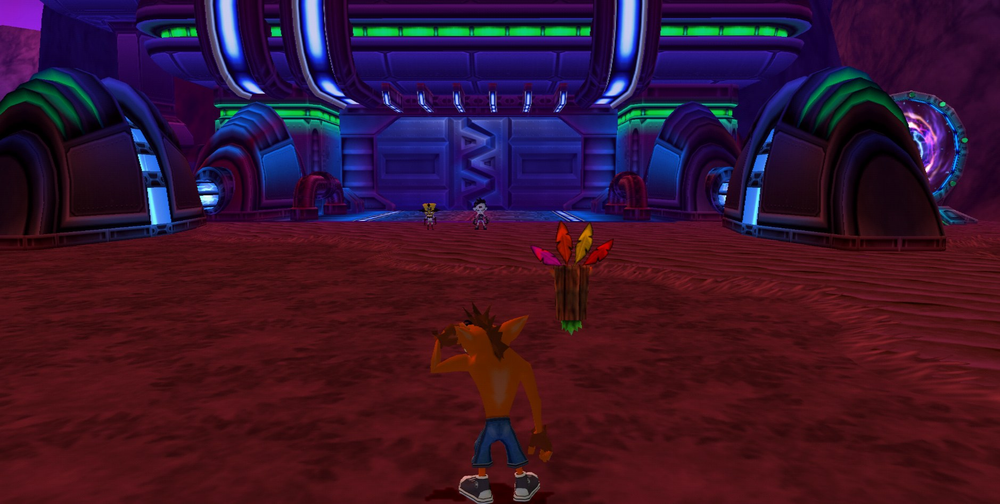

*On 1.2.0.
Screenshot by [NormanTheFox](https://github.com/NormanTheFox), thank you!*

## Credits

**Upstream projects (most of the work):**

- [Smartkin](https://github.com/Smartkin/twinsanity-reversed) and everyone behind the Crash Twinsanity decompilation: every function of the game rewritten in C++, with the tools that build and test it.
- [HAB3X](https://github.com/HAB3X/Crash-Twinsanity-Mac): the native port for Mac.
  This includes the platform layer, the emulation of the PS2's graphics (GS, VIF, VU) and its OpenGL renderer, audio and movies, saves, the options screen and the community fixes.
- [Crash Twinsanity Improved](https://github.com/AlexMollard/Crash-Twinsanity-Improved) by AlexMollard: the optional bug fixes come from this mod, used with AlexMollard's permission ([Crash-Twinsanity-Improved#5](https://github.com/AlexMollard/Crash-Twinsanity-Improved/issues/5)).
  Its 21:9 mode is TechieSaru's fix, from the mod's PCSX2 patches.
- CRASHARKI, for the HD texture pack the Mac port was tested with.
- [SMAA](https://github.com/iryoku/smaa) by Jorge Jimenez, Jose I. Echevarria, Belen Masia, Fernando Navarro and Diego Gutierrez (MIT): the SMAA anti-aliasing.
- [TwinsanityEvolved](https://github.com/menaman123/TwinsanityEvolved) by menaman123, another PC port.
  Code under its MIT licence (the disc image's CRC-32 and SHA-1, and how a text bank's language is told, from its engine NativeEE; its region map tool, which maps the North American disc's executable onto the PAL one), with its notices kept.
  With menaman123's permission ([TwinsanityEvolved#19](https://github.com/menaman123/TwinsanityEvolved/issues/19)), its cutscene skip and its census of the game's cutscenes, under its MIT licence.
  [`native/third_party/twinsanityevolved`](native/third_party/twinsanityevolved/README.md) lists what.

**Contributors and testers of the Windows port:**

- [Gabriel-TwoBits](https://github.com/Gabriel-TwoBits): the Linux build, with its fixes and low memory emulation, named backtraces, and the build script with its AppImage (#1, #2, #3).
- [jeff1-cpu](https://github.com/jeff1-cpu): the automatic camera (#45).
- [NormanTheFox](https://github.com/NormanTheFox): the port's own texts in Brazilian Portuguese (#25).
- The players whose reports and tests made it better: [NitorikoSkye](https://github.com/NitorikoSkye) (the ROG Ally and AMD graphics, the physics past 60 Hz, the movies' crash, many suggestions), [NormanTheFox](https://github.com/NormanTheFox) (the masks' bugs, Vulkan's stops, Bandicoot Pursuit above 60 fps, mods, shadows and many suggestions), [ichagas7](https://github.com/ichagas7) (the double jump, the menus' designs and the level select's saves), [GNRTX-3](https://github.com/GNRTX-3) (the camera, with videos and logs), [GamerAlfa117](https://github.com/GamerAlfa117) (mods and ReShade), [SSStylishh](https://github.com/SSStylishh) (played it to the end), [APerson7778](https://github.com/APerson7778) (mouse look) and [VenezuelanHell](https://github.com/VenezuelanHell) (older AMD drivers).
- [Onaga00](https://github.com/Onaga00), with thanks.

Bug reports, suggestions and pull requests are welcome: see [CONTRIBUTING.md](.github/CONTRIBUTING.md).

**References:**

- [PCSX2](https://github.com/PCSX2/pcsx2): how the PS2's VU, VIF and GS behave, the model of its float maths, and the design of its hardware renderers.
- Microsoft's documentation of the x64 calling convention, and the System V and MIPS EABI conventions.
- [Tenkaichi3Decomp](https://github.com/z3xox/Tenkaichi3Decomp) by z3xox: the design of a renderer that records the GS's work and draws it with OpenGL or SDL's GPU API, at its MIT commit 06e4671.
  No code was taken.

**Tools:**

- [splat](https://github.com/ethteck/splat), [spimdisasm](https://github.com/Decompollaborate/spimdisasm) and [rabbitizer](https://github.com/Decompollaborate/rabbitizer): split the executable.
- [ps2dev](https://github.com/ps2dev/ps2dev): the PS2 toolchain, GCC 15.2 with PS2SDK.
- Ghidra: used upstream for the decompilation's symbols.
- [LLVM-MinGW](https://github.com/mstorsjo/llvm-mingw) by Martin Storsjö (clang 23, UCRT), [CMake](https://cmake.org/) and [Ninja](https://ninja-build.org/): build the Windows program.
- [Python](https://www.python.org/) 3.13 and [Pillow](https://python-pillow.org/): build tools and test scripts.
- [Git for Windows](https://gitforwindows.org/), MSYS2's `make` and [winget](https://github.com/microsoft/winget-cli): build FFmpeg and install the tools.

**Libraries and fonts bundled with the program:**

| What | Licence |
| --- | --- |
| [SDL 3.4.18](https://github.com/libsdl-org/SDL) | zlib |
| [FFmpeg 9.0.2](https://ffmpeg.org/) (libavcodec and libavutil, built with only the MPEG-2 video decoder) | LGPL 2.1 or later ([native/third_party/ffmpeg](native/third_party/ffmpeg)) |
| [glslang 16.6.0](https://github.com/KhronosGroup/glslang) by the Khronos Group (the Vulkan renderer's shaders, built into the program) | 3-Clause BSD, and for some parts 2-Clause BSD, MIT and Apache 2.0 |
| [stb_truetype](https://github.com/nothings/stb) (one fix of ours, marked in the file) | public domain or MIT |
| [Luckiest Guy](https://fonts.google.com/specimen/Luckiest+Guy) | Apache 2.0 |
| [Fredoka](https://fonts.google.com/specimen/Fredoka) | SIL Open Font Licence 1.1 |

[THIRD_PARTY_NOTICES.md](THIRD_PARTY_NOTICES.md) says where each licence's text is, SMAA's and TwinsanityEvolved's too, and what is used with its authors' permission.

**The icon** is our own drawing (`native/tools/draw_icon.py` draws it), under this repository's licence.

**AI assistance:** this port was written with the help of [Claude Code](https://claude.com/claude-code) (Anthropic).
As the developer, I reviewed and supervised the work.
Each commit made with it says so.

## Licence

- **Upstream code:** Smartkin's decompilation and HAB3X's Mac port are published without a licence, so all their rights stay with their authors.
  They are included here, unchanged in the first commit, with the credit above.
- **Crash Twinsanity Improved** (AlexMollard's mod) has no licence either: the parts the port uses are used with AlexMollard's permission ([THIRD_PARTY_NOTICES.md](THIRD_PARTY_NOTICES.md) says which).
- **This repository's own changes** (the commits after the first) are under the MIT licence: see [LICENSE](LICENSE).
- **Third-party libraries and fonts** keep their own licences (table above).
- **The game** (its code, data, art and sound) belongs to Activision.
  None of the game's files are in this repository: the executable, data, art and sound come from your own disc image.

## Gallery
| | |
| --- | --- |
| 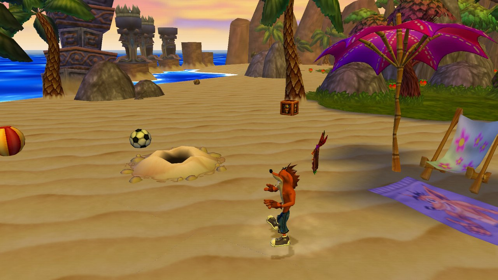 | 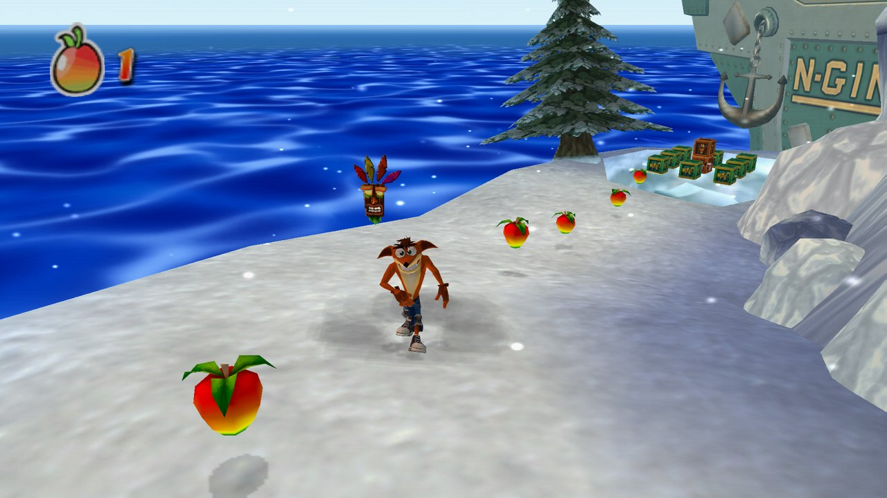 |
| 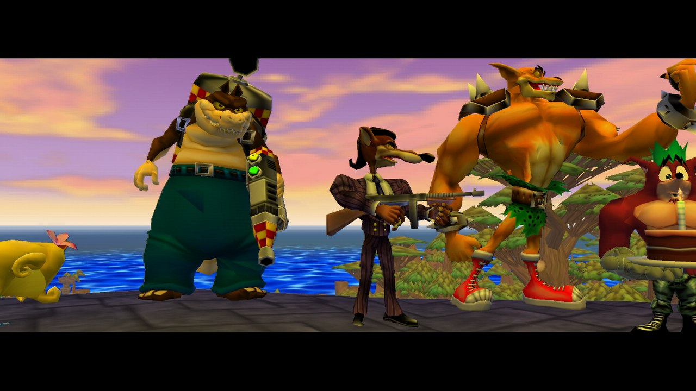 | 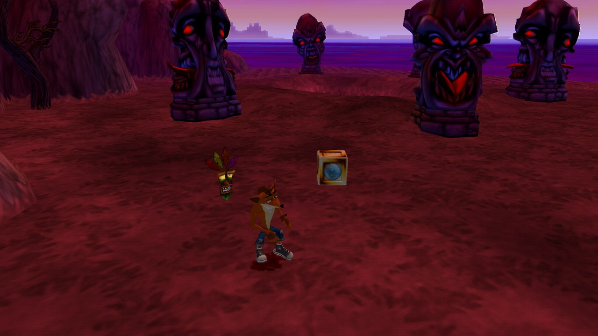 |
| 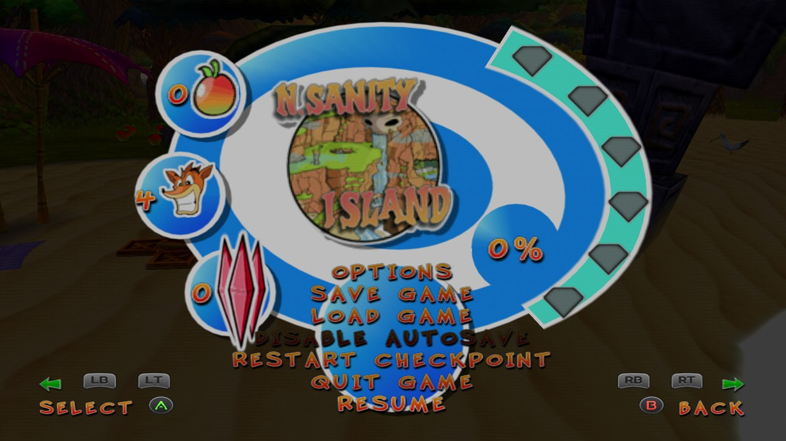 | 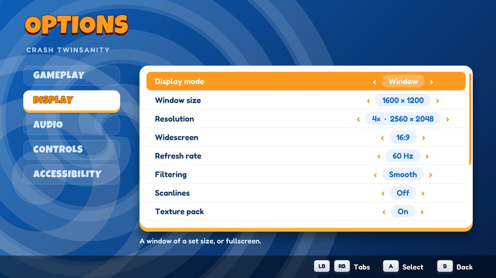 |

*Taken from the Windows program at 4× the PS2's resolution, without texture packs.
The menus show the buttons of the controller in use, and the PC options have their own screen.*
