<div align="center">

# Crash Twinsanity for Windows

**Crash Twinsanity (PlayStation 2) running natively on your PC, on Windows and Linux. No emulator.**

[](https://github.com/GioPixelGH/Crash-Twinsanity-Windows/releases/latest)
[](https://github.com/GioPixelGH/Crash-Twinsanity-Windows/releases)
[](https://github.com/GioPixelGH/Crash-Twinsanity-Windows/discussions)
[](#licence)


[Play it](#play-it) · [Is it safe?](#is-it-safe) · [Features](#features) · [Status](#status) · [Known issues](#known-issues) ·
[If something goes wrong](#if-something-goes-wrong) · [Roadmap](#roadmap) · [Building](#building-on-windows) ·
[Credits](#credits)

</div>

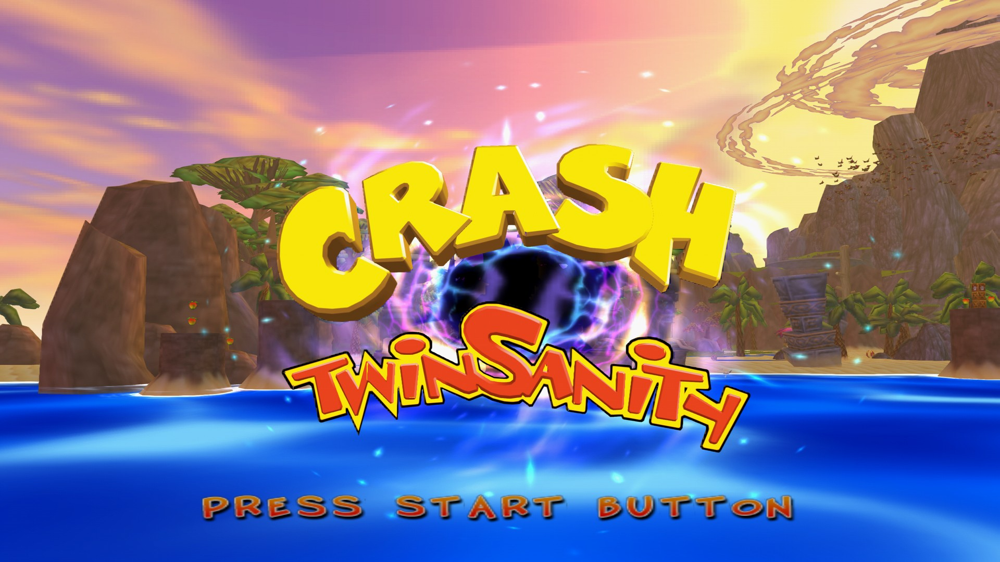

> [!IMPORTANT]
> **Bring your own copy.** No game files are included. You need a disc image of your own PAL copy of the game
> (Europe/Australia, SLES-52568). A translated or modded copy of the PAL disc works too. The North American disc doesn't
> work yet.
>
> Crash Twinsanity and Crash Bandicoot are trademarks of Activision. PlayStation is a trademark of Sony Interactive
> Entertainment. This is a fan project, not affiliated with or endorsed by either. Please don't ask for the game's files
> or disc images in the issues: such requests are closed.

This port is built on two projects. [Smartkin's decompilation](https://github.com/Smartkin/twinsanity-reversed) rewrote
the whole game in C++. [HAB3X's port for Mac](https://github.com/HAB3X/Crash-Twinsanity-Mac) made it run natively. This
repository brings it to Windows and Linux, keeps it at a steady 60 fps, and fixes what playing it turned up.

## Play it

### What you need

- 64-bit Windows 10 or 11, or 64-bit Linux.
- A graphics card with OpenGL 3.3. Any card from the last ten years has it.
- A disc image of **your own** PAL copy of the game, as an `.iso`, `.bin` or `.img`.
- A keyboard and mouse, or a controller. Xbox, PlayStation, Switch and most other controllers work out of the box.

### On Windows

1. Download `Crash-Twinsanity-Windows.zip` from the
   [latest release](https://github.com/GioPixelGH/Crash-Twinsanity-Windows/releases/latest).
2. Unzip it anywhere you like.
3. Open the `Crash Twinsanity` folder and run `CrashTwinsanity.exe`.
4. If Windows says "Windows protected your PC", choose **More info**, then **Run anyway**. The program isn't code-signed.
5. Pick your disc image. The game remembers it.

That's all. The [players' guide](native/PLAYING_WINDOWS.md) explains the options, the controls, the saves and the mods.

### On Linux and the Steam Deck

1. Download `Crash-Twinsanity-Linux-x86_64.AppImage` from the
   [latest release](https://github.com/GioPixelGH/Crash-Twinsanity-Windows/releases/latest).
2. Make it executable: `chmod +x Crash-Twinsanity-Linux-x86_64.AppImage`.
3. Run it, and pick your disc image.

It needs glibc 2.38 or later: Ubuntu 24.04, Linux Mint 22, Debian 13, Fedora 39, Arch, or newer. On older systems, such
as Ubuntu 22.04, Debian 12 or Linux Mint 21, you can build it yourself with [native/LINUX.md](native/LINUX.md).

On a Steam Deck it starts fullscreen on the Deck's screen. [native/LINUX.md](native/LINUX.md) shows how to add it as a
non-Steam game. Nobody has tried it on a Deck yet, so **testers are wanted** ([#34]).

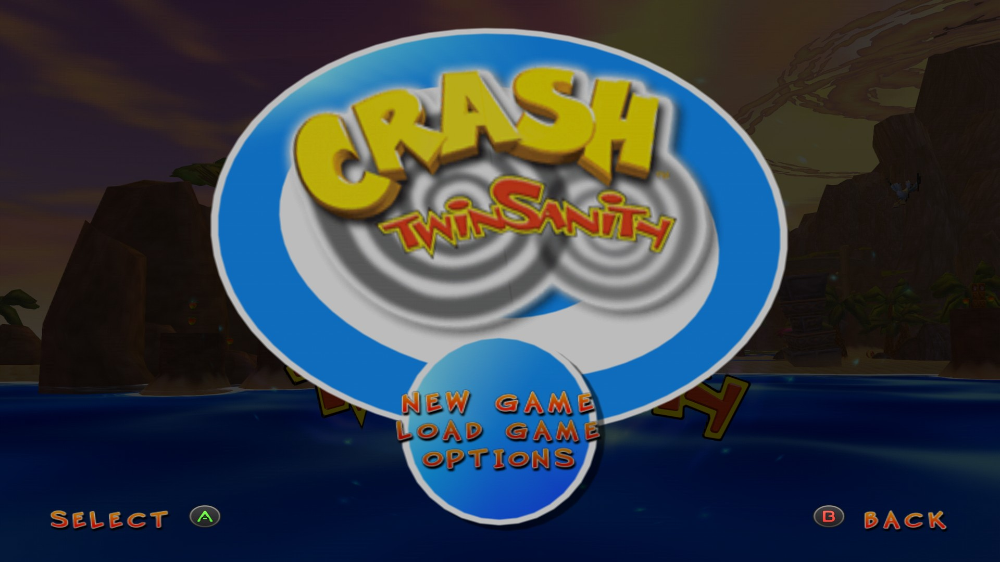

## Is it safe?

- The download holds only the program, its two libraries (SDL 3 and FFmpeg), its fonts and the licences. There's no
  installer.
- The program goes online only if you turn on **Check for updates** (Options > Gameplay, off by default). Then, at each
  start, it asks GitHub which version is the latest. It sends no personal data, and it never downloads or installs anything.
  The Linux version has no update check at all.
- The release page lists each file's SHA-256. You can check your download with `Get-FileHash` on Windows or `sha256sum` on
  Linux. Here is
  [VirusTotal's report on 1.0.12's download](https://www.virustotal.com/gui/url/6ed9050e25993157d30ef77a69c4b7e7aba61368c9669caca1caf95553cd1e90/detection).
- You can also build it yourself from this code ([below](#building-on-windows)).

[SECURITY.md](.github/SECURITY.md) has the details, and how to report a security problem privately.

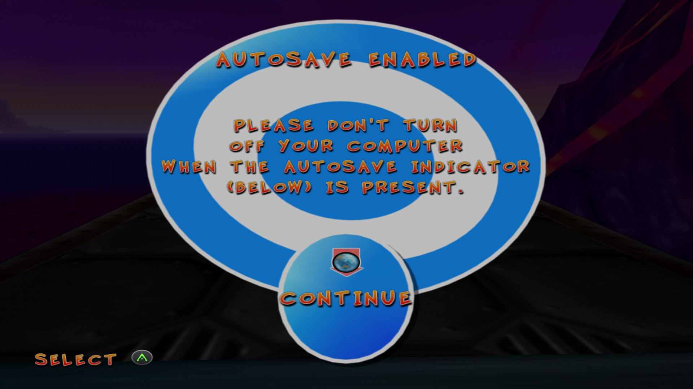

## Features

**Looks**

- Up to 8 times the PS2's resolution, with the characters drawn as they look on the PS2.
- Widescreen in 16:9, 21:9 and 32:9, besides the original 4:3. At 32:9 the menus and the HUD stay in the middle.
- Smooth edges with FXAA, SMAA, or supersampling at 2x or 4x.
- Anisotropic filtering up to 16x, for sharp textures seen at an angle.
- The PS2's dithering, or off for full colour.
- A longer draw distance, if you'd like grass and small things to appear sooner.
- HD texture packs made for PCSX2 work as they are ([how](#texture-packs)).

**Smoothness**

- A steady 60 fps, or 50, 120, 144 or unlimited, always at the same game speed.
- No pauses to prepare graphics when you reach a new area.

**Playing**

- Keyboard and mouse, or any controller, with every key and button remappable.
- The menus show the buttons of the controller you're using.
- The text language and the voice language chosen separately: English text with French voices, for example.
- Saves that work like a PC game's, with no memory card screens.
- Portable mode: everything kept in the game's folder, to carry it on a USB stick.

**Game options** (all off by default, so the game stays the original)

- Skip cutscenes, now including many that had no skip ([#28]).
- Infinite lives.
- A stronger Aku Aku: one or two masks protect you from TNT and Nitro ([#30]).
- An automatic camera: the camera swings behind you by itself and the camera controls turn nothing.
- The slide's long jump at any moment, or an easier one ([#11], [#35]).
- Level select. Its saves are kept apart from yours.
- A speedrun timer.
- A shadow under you in the air, and your shadow on crates.
- Bug fixes for three bugs of the original game: the masks' particles and stars ([#18]), and Evil Crash in Bandicoot Pursuit.

**Mods**

- Mods as the community shares them, Crate Mod Loader's Mod Crates and new levels included ([#36]).
- A mod's zip or a modded disc image imported from Options > Mods.
- Each mod turned on or off, in the order you choose.
- Saves made with mods kept on a memory card of their own.
- A [modding guide](native/MODDING.md) to make your own.

<details>
<summary><b>What changed under the hood</b> (for the curious)</summary>

On top of HAB3X's port (its GPU renderer, widescreen and 21:9, HD texture packs, remappable keyboard, mouse and
controller, saves, cutscene skipping and community fixes), this port adds:

- **Windows support:** Windows' calling convention, which passes float arguments differently from the PS2's; the retail
  code's reads of address 0, emulated on Windows; frame pacing and file access; a crash report with a backtrace and the
  area the player was in.
- **Speed:** the game, the PS2's vector unit (VU1) and the graphics run on three threads, and the renderer's hot paths are
  faster. The graphics' shader programs are made when the game starts.
- **Resolution:** 6x and 8x added. A buffer the graphics card can't hold at the chosen scale is drawn by the software
  renderer instead of failing.
- **Anti-aliasing:** SMAA is [iryoku's](https://github.com/iryoku/smaa). Supersampling draws the picture 2 or 4 times
  larger, up to 8x the PS2's, and shrinks it to the window.
- **Draw distance** comes from HAB3X's Mac port: short, original (the default), medium, long or unlimited.
- **Languages:** a translated disc's texts are recognised by their language ([#25]).
- **Cutscene skip:** besides the developers' own skips, the others end the scene's waits in order (TwinsanityEvolved's
  skip, with its author's permission). Each one was checked to end as when watched.
- **Level select** comes from HAB3X's Mac port, on a memory card of its own.
- **Quit to desktop, a Credits page, and the update check** (Windows only) are in Options > Gameplay.
- **Mods:** each mod is a folder in `%APPDATA%\Crash Twinsanity\mods`, a Mod Crate as it comes or files laid out as the
  disc's. Files put straight in the mods folder replace the disc's, as before.
- **Fixes:**
  - The crash entering the first boss's area (a level title picture read wrongly).
  - The crash during the Mecha-Bandicoot fight (a float argument on Windows).
  - Crashes in the caverns (a reference to an object already freed, an animation of zero length).
  - VU1 programs that ran away (two copies of the same data declared with different sizes).
  - The characters at high resolutions: the game's distance haze and the first boss's sky at the chosen resolution (no
    more stepped outlines), the colours VU1 writes after sending its vertices (no more patches on the bodies), triangles
    thinner than a PS2 pixel (no more thin black lines), and textures' detail for the chosen resolution.
  - Ant Agony's metal doors, walls and floors, which were read from an old buffer of the first boss's area ([#32]).
  - Under the Bug fixes option: the masks' invincibility particles lost in the next area, two masks' stars lost after a
    cutscene ([#18]), and Bandicoot Pursuit's Evil Crash standing still.
- **Controllers:** a modern controller's round stick is mapped to the PS2 stick's square, so Crash runs on diagonals too.
- **The game's data from your disc:** the program carries none of it. It reads the data from your disc image's executable
  when it starts, checks that it's the PAL release, and says so clearly when the disc image is wrong. The log says what the
  image is (the retail disc, a modified copy or an unknown image), by redump.org's dumps.

[native/WINDOWS.md](native/WINDOWS.md) explains each change, why it was needed and how it was tested.

</details>

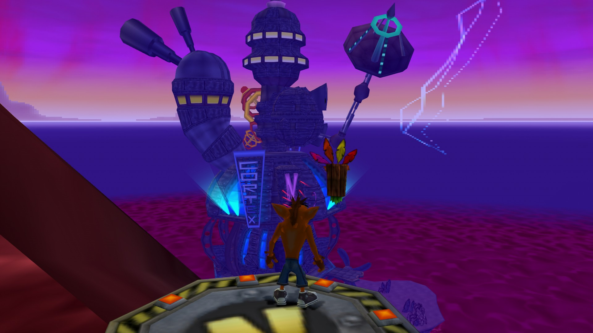

## Status

- **Tested on Windows 11** with an NVIDIA GeForce RTX 4070 SUPER, keyboard and mouse, and an Xbox One controller.
- **Played by hand from the start to the credits**, in Italian with an Xbox One controller, on the releases up to 1.0.7.
  Every crash found on the way is fixed.
- **All 131 of the game's areas were tried** with scripted input, 30 seconds each, with no unexpected crash
  ([results](native/sweep/results_windows.md)). 108 played. The other 23 can only be entered from a neighbouring area.
- **Linux:** built and checked with each release since 1.2.0. It plays on x86-64 (tried on Debian 13).
- **macOS:** HAB3X's code for it is still here, but this fork isn't built or tested on macOS.

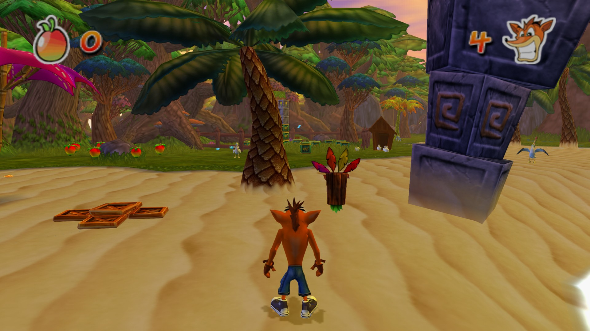

## Known issues

- **The North American disc doesn't work yet** ([#14]). The game says the disc image isn't the PAL release. It's on the
  [roadmap](#roadmap).
- **Older PCs can run well below 60 fps** ([#23], [#39]). The PS2's graphics are emulated on the processor, which is hard
  work for older ones: a two-core laptop processor from 2011 ran it at 18 fps. A faster renderer is on the roadmap.
- **A black screen at start on a few AMD PCs** ([#16]). It doesn't happen on the PC the port is tested on, so a log from
  an affected PC helps.
- **Aku Aku disappears in two cutscenes** ([#18]), by Cavern Catastrophe's excavator and at Dingodile's house. Not solved
  yet.
- **The Steam Deck hasn't been tried** ([#34]). Testers wanted.

## If something goes wrong

| Problem | What to do |
| --- | --- |
| Windows says "Windows protected your PC" | Choose **More info**, then **Run anyway**. The program isn't code-signed. |
| The game asks for the disc image again | You moved or renamed it. Pick it again. To use a different one, delete `disc_image.txt` from the settings folder (below). |
| The game refuses the disc image | It takes only the PAL disc (SLES-52568), or a translated or modded copy of it. The North American disc doesn't work yet ([#14]). |
| A black screen at start | Update your graphics card's driver. If it stays black, attach `log.txt` on [#16]. |
| Below 60 fps | In Options > Display, set Resolution to 1x, Draw distance to short, and Anti-aliasing off. Then attach `log.txt` on [#23]: it says where each frame's time goes. |
| A pause when a new area appears | The first start after a graphics driver update takes a little longer. If the game still pauses while you play, attach `log.txt`: its `slow frame` lines say why. |
| Sounds or a level wrong with mods on | Turn the mods off in Options > Mods, then restart. Saves made with mods are on their own memory card, so yours come back as soon as all mods are off. |

**Before you report a bug**

1. Make sure you have the [latest release](https://github.com/GioPixelGH/Crash-Twinsanity-Windows/releases/latest).
2. Search the [issues](https://github.com/GioPixelGH/Crash-Twinsanity-Windows/issues?q=is%3Aissue) to see if it's known.
3. Attach `log.txt`. After a crash or a freeze, start the game again and attach `log.previous.txt` too: that's the run that
   went wrong.
4. Say where in the game it happened, and add a screenshot or a video if you can.

For a bug you can repeat, turn on **Options > Gameplay > Detailed log** first. Never attach your disc image or the game's
files. Questions and help are welcome in the
[Discussions](https://github.com/GioPixelGH/Crash-Twinsanity-Windows/discussions).

**Where your saves and settings are**

Saves, options, controls, mods, texture packs and `log.txt` are all in one folder:

- on Windows, `%APPDATA%\Crash Twinsanity\` (paste that in the Explorer's address bar);
- on Linux, `~/.config/crash-twinsanity`;
- with **Options > Gameplay > Portable mode** on, the `User` folder beside the program.

To uninstall, delete the game's folder and that one. The [players' guide](native/PLAYING_WINDOWS.md#where-things-are) lists
every file.

## Roadmap

Plans, not promises, roughly from the quickest to the longest. New game options will be off by default, so the game stays
the original.

- [ ] A 16:10 shape for the Steam Deck's screen (the picture is 16:9 there now, with thin bars above and below).
- [ ] The game closing after the end credits instead of going back to the Iceberg Lab ([#20]).
- [ ] Eight save slots.
- [ ] A skip for the cutscenes that still play whole, like the start of the first fight with Cortex and the final boss's
  ([#28]).
- [ ] Aku Aku disappearing in two cutscenes, compared with the original game ([#18]).
- [ ] Frame rates other than 60 checked through the game: the seal chase at 240 fps ([#17]), the cannon's bombs below
  60 fps ([#12]).
- [ ] The black screen at start on some AMD PCs ([#16]).
- [ ] HD texture packs in BC7, and texture upscaling.
- [ ] The characters' shadows at the chosen resolution. They stay at the PS2's, softer than the rest of the picture at
  high resolutions.
- [ ] The North American disc, NTSC-U v2.00 ([#14]): aimed at the next major version.
- [ ] A faster renderer as an option for weaker PCs ([#23], [#37], [#39]): the game's models and scenes drawn straight on
  the graphics card, instead of emulating the PS2's graphics chip a shape at a time. Aimed at the next major version.
- [ ] Achievements, kept on your PC (RetroAchievements doesn't award them for ports).
- [ ] Subtitles for the cutscenes ([#11]).

Maybe later: fast-forwarding cutscenes as well as skipping them ([#9]); two-player co-op; some of the North American
release's differences as options on the PAL disc ([#14]); progress kept when you go back to an area, such as crates broken,
cutscenes seen and challenges done ([#38]); the port's own texts in Brazilian Portuguese, if someone translates them
([#25]); and character packs from the other Crash games (a mod, since it needs those games' discs).

<details>
<summary><b>Done so far</b></summary>

- [x] The characters drawn as on the PS2 at high resolutions ([#15], [#19], [#24]): no more stepped outlines, patches on
  the bodies or thin black lines.
- [x] 6x and 8x the PS2's resolution ([#19]), and a safe fallback when the graphics card refuses one of the renderer's
  buffers.
- [x] A Dithering option ([#24]). The PS2 shows its picture in 16-bit colour with a fine pattern to hide the steps. The
  port reproduces it, and turned off the picture keeps its full colour.
- [x] Draw distance as an option (from HAB3X's Mac port).
- [x] Anti-aliasing by supersampling (2x, 4x).
- [x] A Credits page in the options.
- [x] Quit to desktop in the options ([#33]).
- [x] The text language and the voice language as two options, with translated disc images recognised ([#25]).
- [x] SMAA anti-aliasing, anisotropic filtering, and a 32:9 shape with the menus in the middle.
- [x] The resolution applied when you stop on it, not at each step through the choices ([#39]).
- [x] An update check, off unless you turn it on. It only tells you a newer version is out.
- [x] Infinite lives, a stronger Aku Aku ([#30]) and a speedrun timer, as game options.
- [x] The slide's long jump at any moment, or easier, as a game option ([#11], [#35]).
- [x] A drop shadow under you in the air, and your shadow on crates, as game options ([#11], [#35]).
- [x] Level select, as a game option, with its saves kept apart from yours.
- [x] Mods as the community ships them ([#36]): a mod's sound effects right, Mod Crates used as they come (new levels
  too), zips and modded disc images imported, a Mods page, and their saves kept apart from yours.
- [x] A modding guide ([native/MODDING.md](native/MODDING.md)).
- [x] The two cutscenes that ended a little differently when skipped ([#9]): Classroom Chaos' start and the bear's now end
  as when played.
- [x] A skip for many cutscenes that had none ([#28]), like one of Cavern Catastrophe's, the Tiki Mon's, the party before
  the first fight with Cortex and Henchmania's fight. Each was checked to end as when played.
- [x] The masks' invincibility particles kept when you move into the next area, under the bug fixes option ([#18]).
- [x] With two masks, Aku Aku's stars back after a cutscene, under the bug fixes option ([#18]).
- [x] Bandicoot Pursuit's Evil Crash following his route instead of standing still, under the bug fixes option (found by
  TwinsanityEvolved).
- [x] Ant Agony's metal doors, walls and floors no longer streaked or blocky ([#32]).
- [x] Fewer pauses when you reach a new area ([#23]).
- [x] A log that says what your disc image is, where the renderer's time goes, and what a slow frame was waiting for.
- [x] A Linux download ([#34]), with the Steam Deck's defaults and the steps to add it as a non-Steam game.

</details>

[#9]: https://github.com/GioPixelGH/Crash-Twinsanity-Windows/issues/9
[#11]: https://github.com/GioPixelGH/Crash-Twinsanity-Windows/issues/11
[#12]: https://github.com/GioPixelGH/Crash-Twinsanity-Windows/issues/12
[#14]: https://github.com/GioPixelGH/Crash-Twinsanity-Windows/issues/14
[#15]: https://github.com/GioPixelGH/Crash-Twinsanity-Windows/issues/15
[#16]: https://github.com/GioPixelGH/Crash-Twinsanity-Windows/issues/16
[#17]: https://github.com/GioPixelGH/Crash-Twinsanity-Windows/issues/17
[#18]: https://github.com/GioPixelGH/Crash-Twinsanity-Windows/issues/18
[#19]: https://github.com/GioPixelGH/Crash-Twinsanity-Windows/issues/19
[#20]: https://github.com/GioPixelGH/Crash-Twinsanity-Windows/issues/20
[#23]: https://github.com/GioPixelGH/Crash-Twinsanity-Windows/issues/23
[#24]: https://github.com/GioPixelGH/Crash-Twinsanity-Windows/issues/24
[#25]: https://github.com/GioPixelGH/Crash-Twinsanity-Windows/issues/25
[#28]: https://github.com/GioPixelGH/Crash-Twinsanity-Windows/issues/28
[#30]: https://github.com/GioPixelGH/Crash-Twinsanity-Windows/issues/30
[#32]: https://github.com/GioPixelGH/Crash-Twinsanity-Windows/issues/32
[#33]: https://github.com/GioPixelGH/Crash-Twinsanity-Windows/issues/33
[#34]: https://github.com/GioPixelGH/Crash-Twinsanity-Windows/issues/34
[#35]: https://github.com/GioPixelGH/Crash-Twinsanity-Windows/issues/35
[#36]: https://github.com/GioPixelGH/Crash-Twinsanity-Windows/issues/36
[#37]: https://github.com/GioPixelGH/Crash-Twinsanity-Windows/issues/37
[#38]: https://github.com/GioPixelGH/Crash-Twinsanity-Windows/issues/38
[#39]: https://github.com/GioPixelGH/Crash-Twinsanity-Windows/issues/39

## Texture packs

PCSX2's texture packs for this game work as they are.

1. Put the pack's `SLES-52568` folder into `%APPDATA%\Crash Twinsanity\textures\`.
2. Check that Texture pack is on in Options > Display. It is by default.

The HD texture pack by CRASHARKI that HAB3X's repository shipped isn't included here: get it from its author.

## Building on Windows

You need about 3 GB of disk space, your PAL disc image and an internet connection for the first build.

1. **Install the tools** (PowerShell):

   ```powershell
   winget install MartinStorsjo.LLVM-MinGW.UCRT Kitware.CMake Ninja-build.Ninja Python.Python.3.13 Git.Git
   ```

2. **Get the PS2 toolchain**: download `ps2dev-windows-latest.tar.gz` from
   [ps2dev's latest release](https://github.com/ps2dev/ps2dev/releases/tag/latest) and extract it into `C:\`, which makes
   `C:\ps2dev`. The native build uses its headers to lay out the game's data.

   ```powershell
   tar -xzf "$HOME\Downloads\ps2dev-windows-latest.tar.gz" -C C:\
   ```

3. **Clone this repository and make the Python environment** (in a new PowerShell, so the tools above are found):

   ```powershell
   git clone https://github.com/GioPixelGH/Crash-Twinsanity-Windows.git
   cd Crash-Twinsanity-Windows
   py -3 -m venv .venv
   .venv\Scripts\python.exe -m pip install -r requirements.txt
   .venv\Scripts\python.exe tools\toolchain_dlls.py
   ```

4. **Take the game's executable out of your disc image, check it, and split it**:

   ```powershell
   tar -xf "C:\path\to\Crash Twinsanity (Europe).iso" SLES_525.68
   Get-FileHash -Algorithm SHA1 SLES_525.68    # D41B8D53F733F930CF03D8EA944BEC24429FE57C
   .venv\Scripts\python.exe tools\split.py
   ```

5. **Build** (the first time it also downloads SDL3 and builds a small FFmpeg; Git for Windows' Git Bash is used for that):

   ```powershell
   .venv\Scripts\python.exe native\tools\build_windows.py
   ```

6. **Play**:

   ```powershell
   build\native\cmake\CrashTwinsanity.exe
   ```

   The first time, it asks for your disc image and remembers it. Settings, saves and texture packs are in
   `%APPDATA%\Crash Twinsanity\`.

More on the Windows build: [native/WINDOWS.md](native/WINDOWS.md). On Linux: [native/LINUX.md](native/LINUX.md). The
decompilation itself (the PS2 build that matches the retail executable, and its tools): [README_DECOMP.md](README_DECOMP.md)
and [docs/DEVELOPMENT.md](docs/DEVELOPMENT.md). HAB3X's native layer: [native/NATIVE.md](native/NATIVE.md),
[native/GRAPHICS.md](native/GRAPHICS.md), [native/AUDIO.md](native/AUDIO.md).

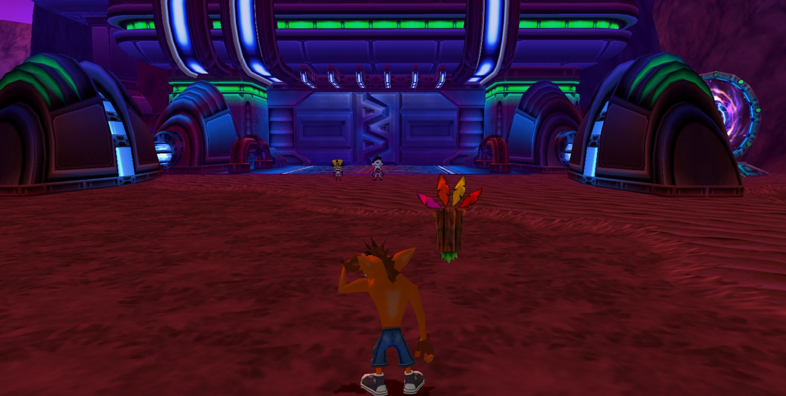

*On 1.2.0. Screenshot by [NormanTheFox](https://github.com/NormanTheFox), thank you!*

## Credits

**Upstream projects (most of the work):**

- [Smartkin](https://github.com/Smartkin/twinsanity-reversed) and everyone behind the Crash Twinsanity decompilation: every
  function of the game rewritten in C++, with the tools that build and test it.
- [HAB3X](https://github.com/HAB3X/Crash-Twinsanity-Mac): the native port for Mac. This includes the platform layer, the
  emulation of the PS2's graphics (GS, VIF, VU) and its OpenGL renderer, audio and movies, saves, the options screen and the
  community fixes.
- [Crash Twinsanity Improved](https://github.com/AlexMollard/Crash-Twinsanity-Improved) by AlexMollard: the Mac port's
  optional fixes come from this mod. Its 21:9 mode is TechieSaru's fix, from the mod's PCSX2 patches.
- CRASHARKI, for the HD texture pack the Mac port was tested with.
- [SMAA](https://github.com/iryoku/smaa) by Jorge Jimenez, Jose I. Echevarria, Belen Masia, Fernando Navarro and Diego
  Gutierrez (MIT): the SMAA anti-aliasing.
- [TwinsanityEvolved](https://github.com/menaman123/TwinsanityEvolved) by menaman123, another PC port. Code under its MIT
  licence (the disc image's CRC-32 and SHA-1, and how a text bank's language is told, from its engine NativeEE), with its
  notices kept. With menaman123's permission
  ([TwinsanityEvolved#19](https://github.com/menaman123/TwinsanityEvolved/issues/19)), its cutscene skip and its census of
  the game's cutscenes, under its MIT licence.
  [`native/third_party/twinsanityevolved`](native/third_party/twinsanityevolved/README.md) lists what.

**Contributors and testers of the Windows port:**

- [Gabriel-TwoBits](https://github.com/Gabriel-TwoBits): the Linux build, with its fixes and low memory emulation, named
  backtraces, and the build script with its AppImage (#1, #2, #3).
- The players whose reports and tests made it better: [NitorikoSkye](https://github.com/NitorikoSkye) (the ROG Ally and AMD
  graphics, the physics past 60 Hz, many suggestions), [SSStylishh](https://github.com/SSStylishh) (played it to the end),
  [APerson7778](https://github.com/APerson7778) (mouse look) and [VenezuelanHell](https://github.com/VenezuelanHell) (older
  AMD drivers).
- [Onaga00](https://github.com/Onaga00), with thanks.

Bug reports, suggestions and pull requests are welcome: see [CONTRIBUTING.md](.github/CONTRIBUTING.md).

**References:**

- [PCSX2](https://github.com/PCSX2/pcsx2): how the PS2's VU, VIF and GS behave, the model of its float maths, and the design
  of its hardware renderers.
- Microsoft's documentation of the x64 calling convention, and the System V and MIPS EABI conventions.

**Tools:**

- [splat](https://github.com/ethteck/splat), [spimdisasm](https://github.com/Decompollaborate/spimdisasm) and
  [rabbitizer](https://github.com/Decompollaborate/rabbitizer): split the executable.
- [ps2dev](https://github.com/ps2dev/ps2dev): the PS2 toolchain, GCC 15.2 with PS2SDK.
- Ghidra: used upstream for the decompilation's symbols.
- [LLVM-MinGW](https://github.com/mstorsjo/llvm-mingw) by Martin Storsjö (clang 23, UCRT), [CMake](https://cmake.org/) and
  [Ninja](https://ninja-build.org/): build the Windows program.
- [Python](https://www.python.org/) 3.13 and [Pillow](https://python-pillow.org/): build tools and test scripts.
- [Git for Windows](https://gitforwindows.org/), MSYS2's `make` and [winget](https://github.com/microsoft/winget-cli): build
  FFmpeg and install the tools.

**Libraries and fonts bundled with the program:**

| What | Licence |
| --- | --- |
| [SDL 3.4.18](https://github.com/libsdl-org/SDL) | zlib |
| [FFmpeg 9.0.2](https://ffmpeg.org/) (libavcodec and libavutil, built with only the MPEG-2 video decoder) | LGPL 2.1 or later ([native/third_party/ffmpeg](native/third_party/ffmpeg)) |
| [stb_truetype](https://github.com/nothings/stb) (one fix of ours, marked in the file) | public domain or MIT |
| [Luckiest Guy](https://fonts.google.com/specimen/Luckiest+Guy) | Apache 2.0 |
| [Fredoka](https://fonts.google.com/specimen/Fredoka) | SIL Open Font Licence 1.1 |

[THIRD_PARTY_NOTICES.md](THIRD_PARTY_NOTICES.md) says where each licence's text is, SMAA's and TwinsanityEvolved's too.

**The icon** is our own drawing (`native/tools/draw_icon.py` draws it), under this repository's licence.

**AI assistance:** this port was written with the help of [Claude Code](https://claude.com/claude-code) (Anthropic). As the
developer, I reviewed and supervised the work. Each commit made with it says so.

## Licence

- **Upstream code:** Smartkin's decompilation and HAB3X's Mac port are published without a licence, so all their rights
  stay with their authors. They are included here, unchanged in the first commit, with the credit above.
- **This repository's own changes** (the commits after the first) are under the MIT licence: see [LICENSE](LICENSE).
- **Third-party libraries and fonts** keep their own licences (table above).
- **The game** (its code, data, art and sound) belongs to Activision. None of the game's files are in this repository:
  the executable, data, art and sound come from your own disc image.

## Gallery
| | |
| --- | --- |
| 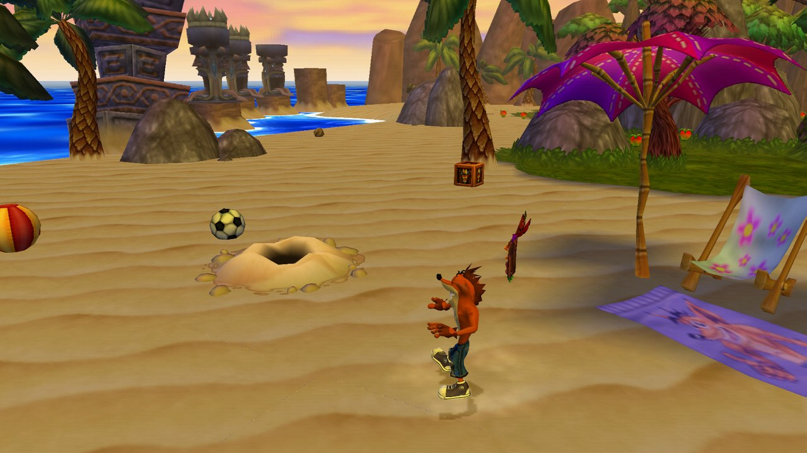 | 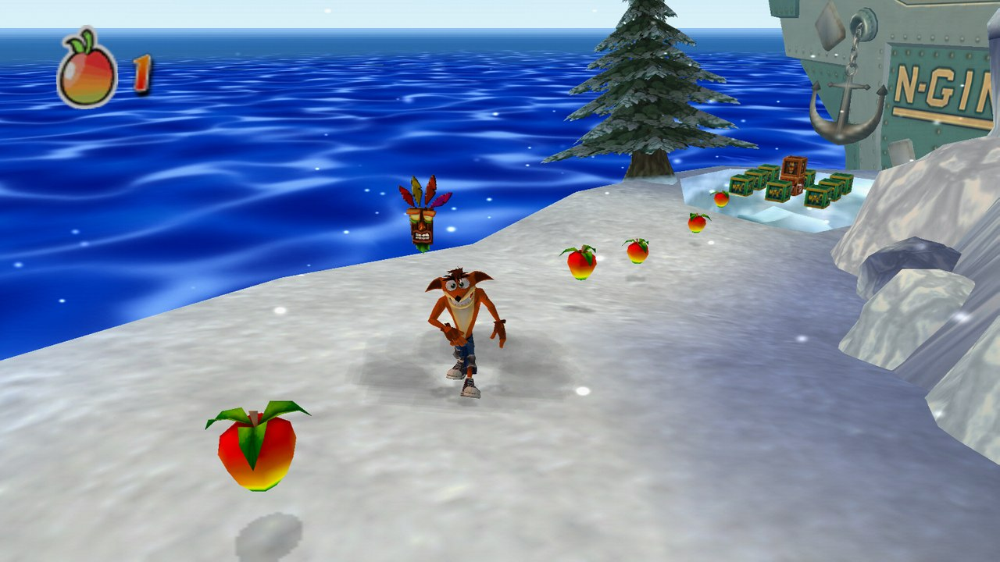 |
| 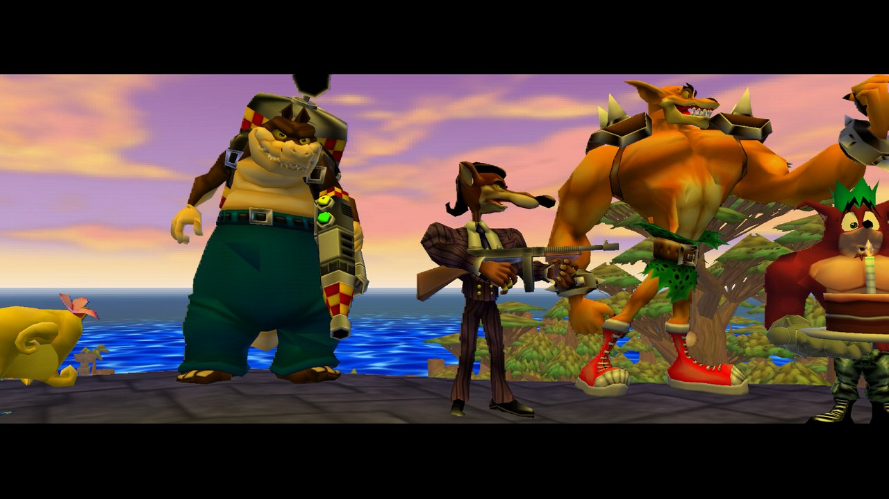 | 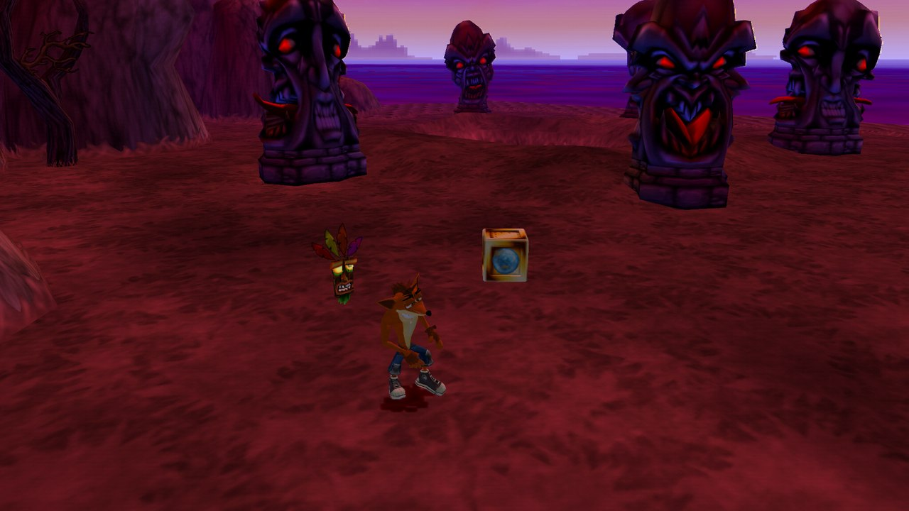 |
| 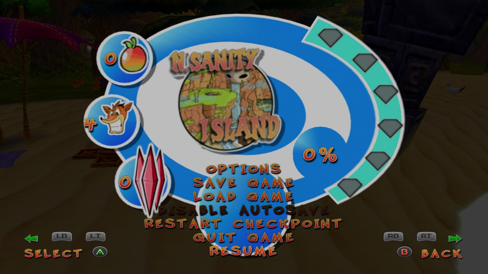 | 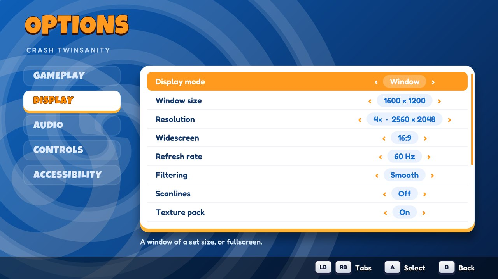 |

*Taken from the Windows program at 4× the PS2's resolution, without texture packs. The menus show the
buttons of the controller in use, and the PC options have their own screen.*
