<div align="center">

# Crash Twinsanity for Windows

Crash Twinsanity (PlayStation 2, PAL) running natively on 64-bit Windows, without an emulator.


This is a Windows port of [HAB3X's Crash Twinsanity for Mac](https://github.com/HAB3X/Crash-Twinsanity-Mac). The Mac port runs
[Smartkin's complete C++ decompilation of the game](https://github.com/Smartkin/twinsanity-reversed) on a native platform layer
(SDL3, an OpenGL renderer for the PS2's graphics, sound, movies, saves and a new options screen).This repository adds what
Windows needs, makes it run at a steady 60 fps, and fixes the crashes found by playing it.

</div>

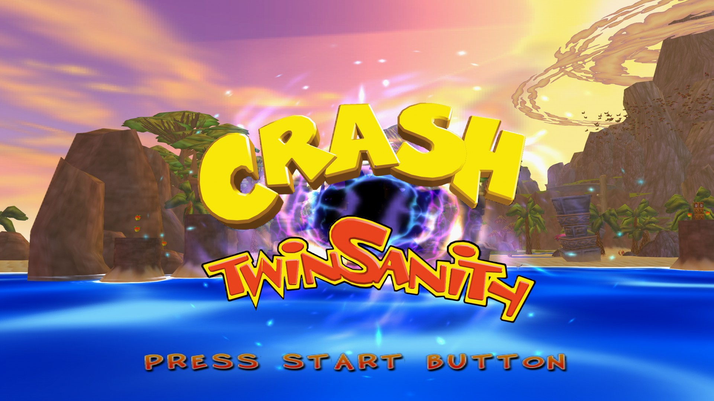

> [!IMPORTANT]
> **No game data is included.** You need your own copy of the PAL game (Europe/Australia, SLES-52568) as a disc image.
> Crash Twinsanity and Crash Bandicoot are trademarks of Activision. PlayStation is a trademark of Sony Interactive
> Entertainment. This is a fan project, not affiliated with or endorsed by either.

## Download

The [latest release](https://github.com/GioPixelGH/Crash-Twinsanity-Windows/releases/latest) has
`Crash-Twinsanity-Windows.zip` for 64-bit Windows 10 and 11: unzip it anywhere, run `CrashTwinsanity.exe` in the
`Crash Twinsanity` folder and pick your disc image. Version 1.0.8 is the first full release, now that the game has been
played from the start to the credits; the ones before were previews. Linux has no download yet: build it yourself
([native/LINUX.md](native/LINUX.md)).

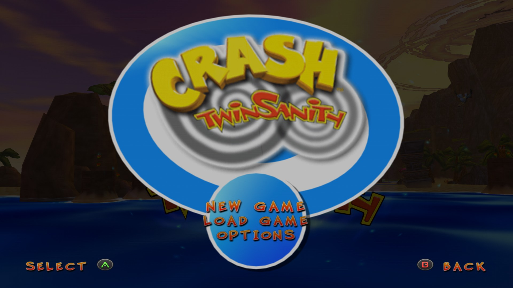

## Is it safe?

- The zip holds only the program built from this repository's code, the SDL 3 and FFmpeg libraries, two fonts and the
  licences. There's no installer, and the program has no network code.
- The release page shows the zip's SHA-256, so you can check your download with `Get-FileHash`. Here is
  [VirusTotal's report on 1.0.12's download](https://www.virustotal.com/gui/url/6ed9050e25993157d30ef77a69c4b7e7aba61368c9669caca1caf95553cd1e90/detection).
- The program isn't code-signed, so Windows may say "Windows protected your PC" the first time: choose **More info**, then
  **Run anyway**.
- You can also build it yourself (below).

More in [SECURITY.md](.github/SECURITY.md), including how to report a security problem privately.

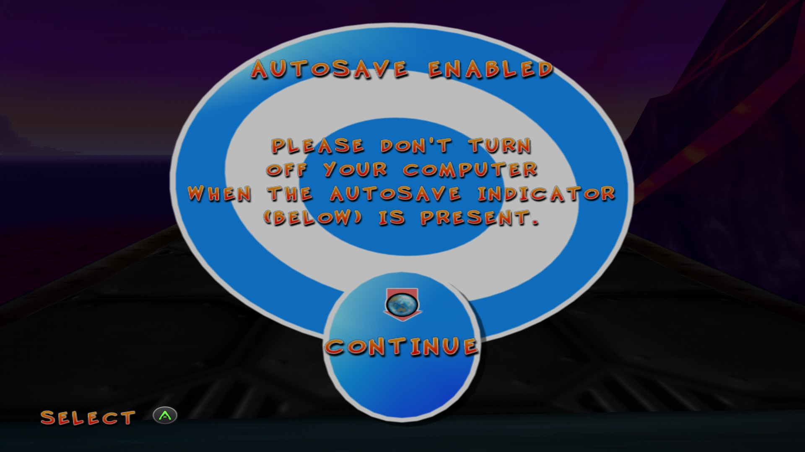

## Status

- **Tested on Windows 11** with an NVIDIA GeForce RTX 4070 SUPER, keyboard and mouse, and an Xbox One controller.
- **Played by hand from the start to the credits**, in Italian with an Xbox One controller, on the releases up to 1.0.7.
  Every crash found on the way is fixed (the last ones: Slip Slide Icecapades' mines in 1.0.5, after beating Dingodile in
  1.0.7).
- **All 131 of the game's areas were tried** with scripted input for 30 seconds each, with no unexpected crash
  ([native/sweep/results_windows.md](native/sweep/results_windows.md)). 108 played (7 of them until a game over); the other
  23 can't be started on their own, because they are parts of hubs or tunnels only entered from a neighbouring area.
- **Known issue:** a cutscene in the level after the caverns (Cortex running with the bees) froze once when it was played
  again after dying, in an early version. It hasn't happened since 1.0.3, and it was never reproduced.
- **Linux:** builds and plays on x86-64 (tried on Debian 13), and packs into an AppImage: see
  [native/LINUX.md](native/LINUX.md).
- **macOS:** the platform code is HAB3X's and the Windows changes are kept apart (`_WIN32`), but this fork isn't built or
  tested on macOS.

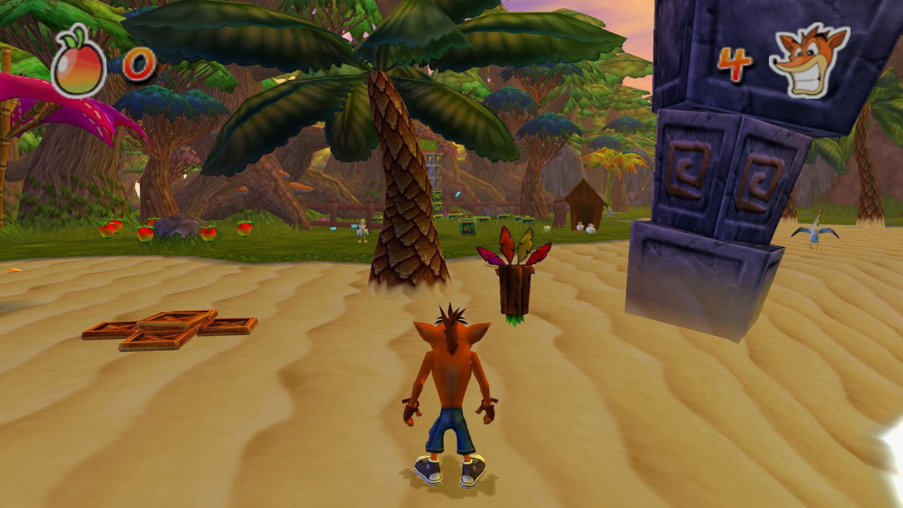

## What this port adds

On top of HAB3X's port (GPU renderer up to 8x the PS2's resolution, widescreen and 21:9, HD texture packs, remappable keyboard,
mouse and controller, saves, cutscene skipping, community fixes):

- **Windows support:**
  - Windows' calling convention, which passes float arguments differently from the PS2's.
  - The retail code's reads of address 0, emulated on Windows.
  - Frame pacing and file access.
  - A crash report with a backtrace and the area the player was in.
- **Speed:** a steady 60 fps everywhere tested. The game, the PS2's vector unit (VU1) and the graphics now run on three
  threads, and the renderer's hot paths are faster.
- **Frame rates:** 50, 60, 120 and 144 Hz, or unlimited, at the same game speed.
- **Language option:** English, French, German, Italian or Spanish texts, voices and movies, chosen in Options.
- **Mods:** files in `%APPDATA%\Crash Twinsanity\mods` replace the disc's, including files inside the game's archive.
  `--list-files` and `--extract` help to start one.
- **Portable mode** (Options > Gameplay, off by default): settings, saves and mods in a `User` folder beside the game, and the
  disc image found in the game's folder, to carry it on a USB stick.
- **Fixes:**
  - The crash entering the first boss's area (a level title picture read wrongly).
  - The crash during the Mecha-Bandicoot fight (a float argument on Windows).
  - Crashes in the caverns (a reference to an object already freed, an animation of zero length).
  - VU1 programs that ran away (two copies of the same data declared with different sizes).
- **Controllers:** a modern controller's round stick is mapped to the PS2 stick's square, so Crash runs on diagonals too.
- **The game's data from your disc:** the program carries none of the game's data. It reads the data from your disc image's
  executable when it starts, checks that it's the PAL release, and says so clearly when the disc image is wrong.

[native/WINDOWS.md](native/WINDOWS.md) explains each change, with the reasons and how they were tested.
[native/PLAYING_WINDOWS.md](native/PLAYING_WINDOWS.md) is the player's guide: options, controls, saves, mods.

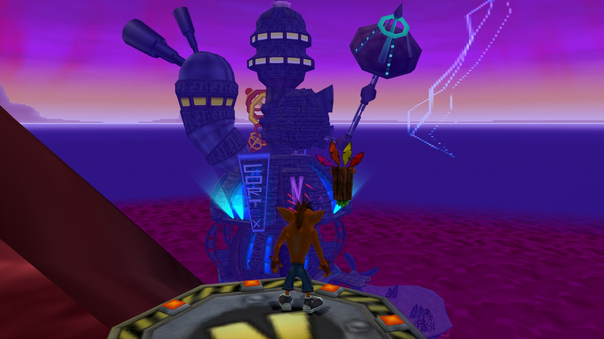

## Building on Windows

You need about 3 GB of disk space, your PAL disc image and an internet connection for the first build.

1. **Install the tools** (PowerShell):

   ```powershell
   winget install MartinStorsjo.LLVM-MinGW.UCRT Kitware.CMake Ninja-build.Ninja Python.Python.3.13 Git.Git
   ```

2. **Get the PS2 toolchain**: download `ps2dev-windows-latest.tar.gz` from
   [ps2dev's latest release](https://github.com/ps2dev/ps2dev/releases/tag/latest) and extract it into `C:\`, which makes `C:\ps2dev`.
   The native build uses its headers to lay out the game's data.

   ```powershell
   tar -xzf "$HOME\Downloads\ps2dev-windows-latest.tar.gz" -C C:\
   ```

3. **Clone this repository and make the Python environment** (in a new PowerShell, so the tools above are found):

   ```powershell
   git clone https://github.com/GioPixelGH/Crash-Twinsanity-Windows.git
   cd Crash-Twinsanity-Windows
   py -3 -m venv .venv
   .venv\Scripts\python.exe -m pip install -r requirements.txt
   .venv\Scripts\python.exe tools\toolchain_dlls.py
   ```

4. **Take the game's executable out of your disc image, check it, and split it**:

   ```powershell
   tar -xf "C:\path\to\Crash Twinsanity (Europe).iso" SLES_525.68
   Get-FileHash -Algorithm SHA1 SLES_525.68    # D41B8D53F733F930CF03D8EA944BEC24429FE57C
   .venv\Scripts\python.exe tools\split.py
   ```

5. **Build** (the first time it also downloads SDL3 and builds a small FFmpeg; Git for Windows' Git Bash is used for that):

   ```powershell
   .venv\Scripts\python.exe native\tools\build_windows.py
   ```

6. **Play**:

   ```powershell
   build\native\cmake\CrashTwinsanity.exe
   ```

   The first time, it asks for your disc image and remembers it. Settings, saves and texture packs are in
   `%APPDATA%\Crash Twinsanity\`.

More on the Windows build: [native/WINDOWS.md](native/WINDOWS.md). The decompilation itself (the PS2 build that matches the
retail executable, and its tools): [README_DECOMP.md](README_DECOMP.md) and [docs/DEVELOPMENT.md](docs/DEVELOPMENT.md).
HAB3X's native layer: [native/NATIVE.md](native/NATIVE.md), [native/GRAPHICS.md](native/GRAPHICS.md),
[native/AUDIO.md](native/AUDIO.md).

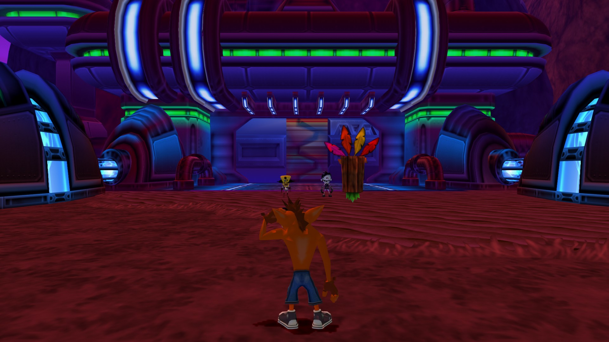

## Texture packs

PCSX2's texture packs for this game work as they are. Put the pack's `SLES-52568` folder into
`%APPDATA%\Crash Twinsanity\textures\` and turn texture packs on in Options. The HD texture pack by CRASHARKI that HAB3X's
repository shipped isn't included here: get it from its author.

## Credits

**Upstream projects (most of the work):**

- [Smartkin](https://github.com/Smartkin/twinsanity-reversed) and everyone behind the Crash Twinsanity decompilation: every
  function of the game rewritten in C++, with the tools that build and test it.
- [HAB3X](https://github.com/HAB3X/Crash-Twinsanity-Mac): the native port for Mac. This includes the platform layer, the
  emulation of the PS2's graphics (GS, VIF, VU) and its OpenGL renderer, audio and movies, saves, the options screen and the
  community fixes.
- [Crash Twinsanity Improved](https://github.com/AlexMollard/Crash-Twinsanity-Improved) by AlexMollard: the Mac port's
  optional fixes come from this mod. Its 21:9 mode is TechieSaru's fix, from the mod's PCSX2 patches.
- CRASHARKI, for the HD texture pack the Mac port was tested with.

**Contributors and testers of the Windows port:**

- [Gabriel-TwoBits](https://github.com/Gabriel-TwoBits): the Linux build, with its fixes and low memory emulation, named
  backtraces, and the build script with its AppImage (#1, #2, #3).
- The players whose reports and tests made it better: [NitorikoSkye](https://github.com/NitorikoSkye) (the ROG Ally and AMD
  graphics, the physics past 60 Hz, many suggestions), [SSStylishh](https://github.com/SSStylishh) (played it to the end),
  [APerson7778](https://github.com/APerson7778) (mouse look) and [VenezuelanHell](https://github.com/VenezuelanHell) (older
  AMD drivers).

Bug reports, suggestions and pull requests are welcome: see [CONTRIBUTING.md](.github/CONTRIBUTING.md).

**References:**

- [PCSX2](https://github.com/PCSX2/pcsx2): how the PS2's VU, VIF and GS behave, the model of its float maths, and the design
  of its hardware renderers.
- Microsoft's documentation of the x64 calling convention, and the System V and MIPS EABI conventions.

**Tools:**

- [splat](https://github.com/ethteck/splat), [spimdisasm](https://github.com/Decompollaborate/spimdisasm) and
  [rabbitizer](https://github.com/Decompollaborate/rabbitizer): split the executable.
- [ps2dev](https://github.com/ps2dev/ps2dev): the PS2 toolchain, GCC 15.2 with PS2SDK.
- Ghidra: used upstream for the decompilation's symbols.
- [LLVM-MinGW](https://github.com/mstorsjo/llvm-mingw) by Martin Storsjö (clang 22, UCRT), [CMake](https://cmake.org/) and
  [Ninja](https://ninja-build.org/): build the Windows program.
- [Python](https://www.python.org/) 3.13 and [Pillow](https://python-pillow.org/): build tools and test scripts.
- [Git for Windows](https://gitforwindows.org/), MSYS2's `make` and [winget](https://github.com/microsoft/winget-cli): build
  FFmpeg and install the tools.

**Libraries and fonts bundled with the program:**

| What | Licence |
| --- | --- |
| [SDL 3.4.18](https://github.com/libsdl-org/SDL) | zlib |
| [FFmpeg 9.0.2](https://ffmpeg.org/) (libavcodec and libavutil, built with only the MPEG-2 video decoder) | LGPL 2.1 or later ([native/third_party/ffmpeg](native/third_party/ffmpeg)) |
| [stb_truetype](https://github.com/nothings/stb) (one fix of ours, marked in the file) | public domain or MIT |
| [Luckiest Guy](https://fonts.google.com/specimen/Luckiest+Guy) | Apache 2.0 |
| [Fredoka](https://fonts.google.com/specimen/Fredoka) | SIL Open Font Licence 1.1 |

**The icon** is our own drawing (`native/tools/draw_icon.py` draws it), under this repository's licence.

**AI assistance:** this port was written with the help of [Claude Code](https://claude.com/claude-code) (Anthropic). As the
developer, I reviewed and supervised the work. Each commit made with it says so.

## Licence

- **Upstream code:** Smartkin's decompilation and HAB3X's Mac port are published without a licence: all their rights stay
  with their authors. They are included here, unchanged in the first commit, with the credit above.
- **This repository's own changes** (the commits after the first) are under the MIT licence: see [LICENSE](LICENSE).
- **Third-party libraries and fonts** keep their own licences (table above).
- **The game** (its code, data, art and sound) belongs to Activision. None of the game's files are in this repository:
  the executable, data, art and sound come from your own disc image.

## Gallery
| | |
| --- | --- |
| 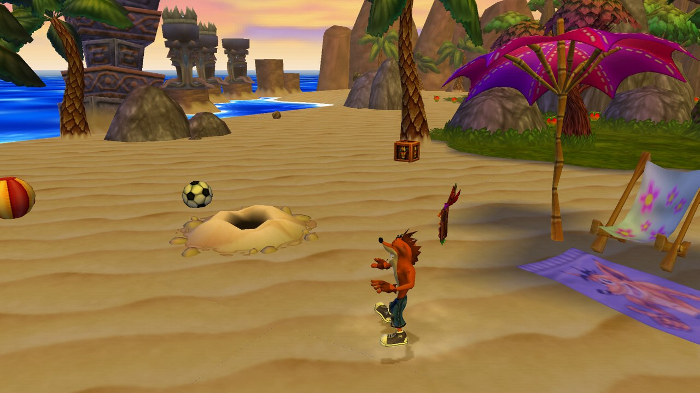 | 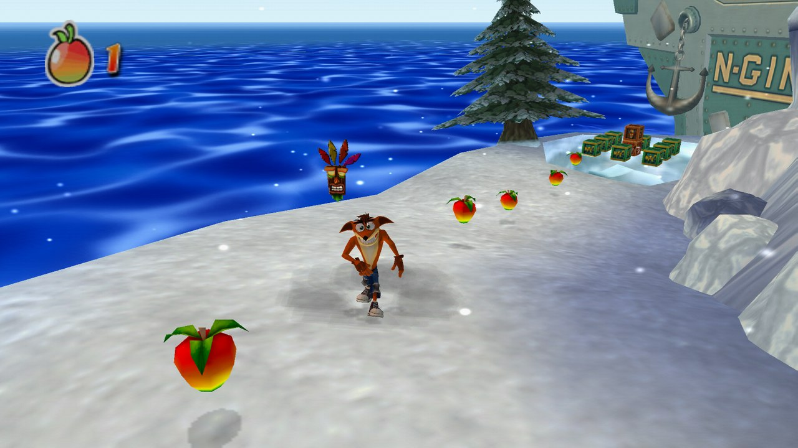 |
| 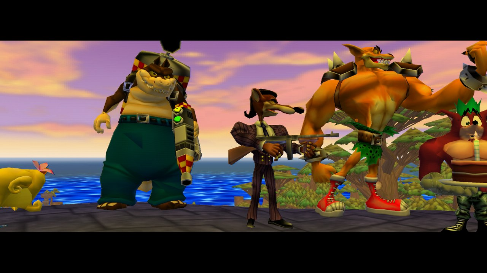 | 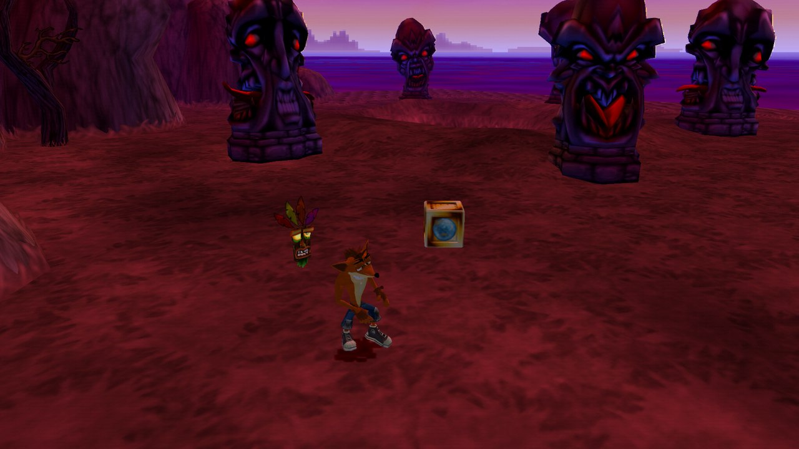 |
| 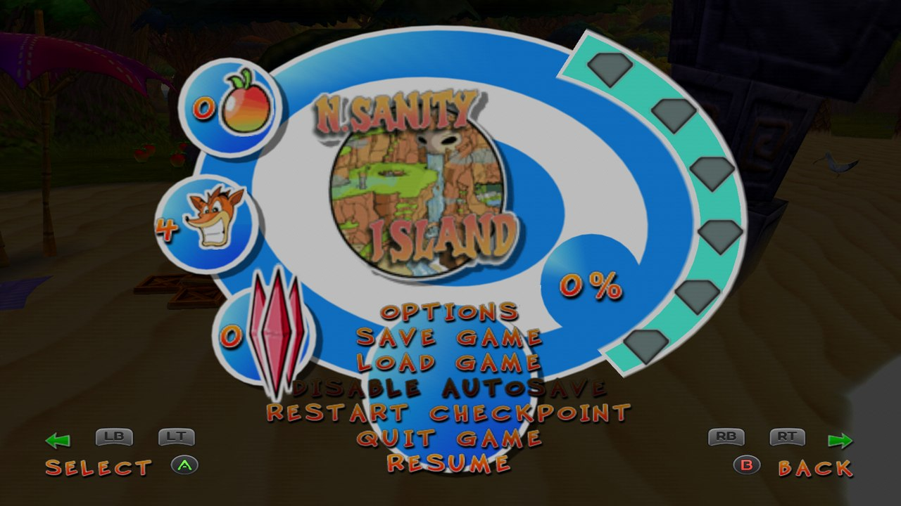 | 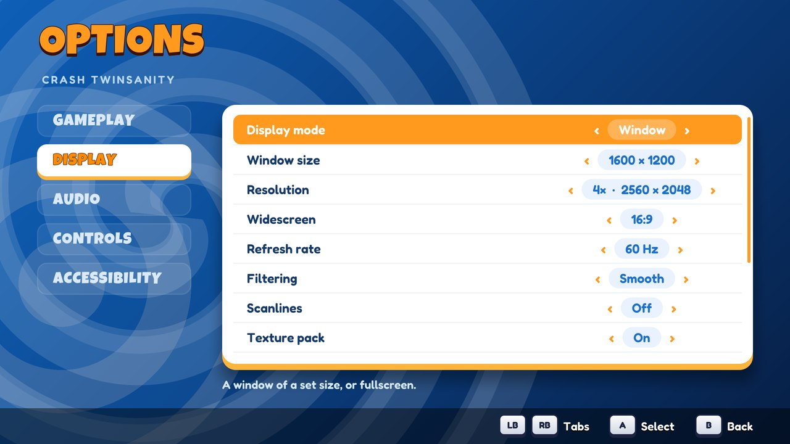 |

*Taken from the Windows program at 4× the PS2's resolution, without texture packs. The menus show the
buttons of the controller in use, and the PC options have their own screen.*
